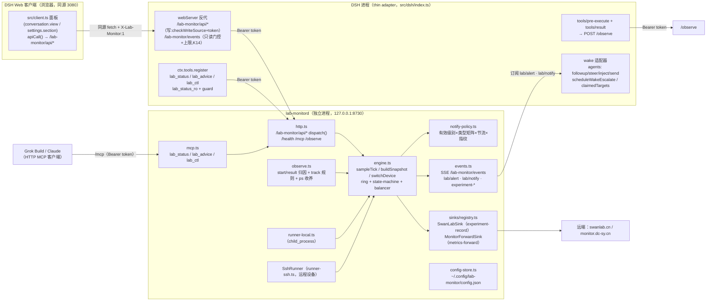
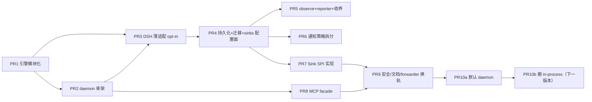

# lab-monitor 守护进程化拆分设计（多 Agent 共享本地监控引擎）

- **作者**：lab-monitor design（glm-5.3 draft, Atria review）
- **日期**：2026-10-26
- **状态**：Accepted（2026-10-26 定稿；2026-10-27 修订 K12：daemon 自行常驻，DSH 不负责启动，只做展示。其余三项裁定见 §11）
- **范围**：`/home/dc/projects/lab-monitor`（V2 正式插件，当前 2.0.0）；把「DSH 进程内 Cordis 插件」拆成「本地长驻 daemon + 三个客户端前端（DSH 适配插件 / MCP facade / 转发器 sink）」
- **读者**：熟悉本仓库的资深工程师；本文是**实现规格**，读完应能不开脑洞地动工

---

## 1. Overview

lab-monitor 今天是一个 Cordis 插件（`src/index.ts`，2647 行）：采样、ring、状态机、平衡引擎、阈值、track 规则、历史、SwanLab 同步、HTTP 数据面、DSH 工具注册全部活在 DSH 进程里（`apply(ctx, config)` + `inject = ['shell', 'timer', 'webServer', 'tools']`）。这带来三个结构性问题：DSH 重启即丢 ring 与在途实验；Grok Build / Claude 等其他 harness 无法复用引擎；出站集成（SwanLab 同步、monitor.dc-sy.cn 转发）硬编码在宿主生命周期里，没有扩展模型。

本设计把引擎抽成**单实例本地 daemon**（Node ESM 进程，WSL 内运行，监听 `127.0.0.1:8730`）：daemon 拥有采样（本地 `child_process` Runner + 既有 `SshRunner` 远程设备）、ring、状态机、平衡引擎、阈值、track/tag/watch 规则、历史、通知策略与全部出站 sink。它的生命周期不经过 DSH：由 `lab-monitord.sh run --supervise` 自己保活，Windows 登录计划任务负责把这条监督循环拉起来（§5.2，2026-10-27 修订）。DSH 没开、DSH 崩溃、当天从不打开 DSH，采样、ring、sink 都继续。引擎对外契约**不变**：继续是 lab-protocol 的 HTTP JSON API（`/lab-monitor/api/*`）+ SSE（`/lab-monitor/events`，见 `docs/reference/protocol.md`），只做增量扩展（observe 入口、sink 状态面、`lab/notify` 事件）。DSH 的必需角色只有展示：webServer 反向代理 `/lab-monitor/*` 到 daemon（浏览器仍同源访问 3080，`src/client.ts` 几乎零改动）。插件**禁止** `spawn` daemon。DSH 会话在线时可以额外挂工具代理、bash reporter 和 wake 投递，这三件都是会话客户端，不参与进程的启动和保活。Grok Build 走 daemon 自带的 **HTTP MCP facade**（`/mcp`，streamable HTTP），同 Vision-MCP 修复模式（`type: http`，一 daemon 多客户端，零 stdio 常驻泄漏）。出站集成为一等扩展点：**两类 sink SPI**（experiment-record 同步 / metrics 转发），SwanLab 与 monitor.dc-sy.cn 是两个参考适配器。持久化从 DSH settings.yaml `lab-monitor` 段迁到 daemon 自有配置文件，含一次性迁移。

## 2. Background & Motivation

### 2.1 现状（代码事实）

- 插件入口 `src/index.ts`：`export const name = 'lab-monitor'`，`export const inject = ['shell', 'timer', 'webServer', 'tools']`；`apply()` 内闭包组装 ring（`createRing(1000, 30*60_000)`）、`createStateMachine`、`createBalancer`、采样 tick（`ctx.interval(sampleTick, cfg.sampleMs)`，2s；ps 5s 周期 `PS_INTERVAL_MS`）、`buildSnapshot()`、`switchDevice()`、SSE（`sseHandler`，缓冲 20、心跳 15s）、CSRF 校验（`checkWriteSource` / `isLocalOriginUrl`，`MAX_BODY_BYTES = 1<<20`）、工具注册（`lab_status`/`lab_advice`/`lab_ctl` + 子代理 `lab_status_ro` + `ctx.tools.guard`）、`preExecHandler`（`tools/pre-execute`，仅 `bash` 工具，trackRules 优先 → `matchTrainFeature` → `machine.start`）、`resultHandler`（`tools/result`，指纹配对 → `machine.markResult`）、`notifyAlerts`（agents 服务 `roots()`/`get(id)` → `followup/steer/inject/send`）、`persistState`（dsh-settings 命名空间 `lab-monitor`，`settingsRetry` 10×500ms 重探）。
- 采样通道：`makeRunner(ctx.shell, ctx)`（DSH shell 服务，`sandboxPolicy: danger-full-access`）实现 `Runner`（`src/sampler/backend-interface.ts`）；远程设备 `SshRunner`（`src/sampler/runner-ssh.ts`，ControlMaster 复用）包本地 Runner。`src/core/*` 与 `src/sampler/*` 已不 import DSH 包——边界现成。
- 出站集成现状：
  - **实验记录同步**：`src/sync/swanlab.ts` 的 `syncRunToSwanLab(run, options)` / `syncAllEligibleRuns(runs, options)`，触发 = `lab/experiment-end` 事件（`triggerMode: 'auto'`）/ 定时（`setupScheduledSync`，`triggerMode: 'scheduled'`）/ 手动（`lab_ctl sync-swanlab` → `rpcSwanLabSync` → `POST /lab-monitor/api/swanlabSync`）。读 run + ring（`extractMetricsForRun` 降级 summary-only）、`sanitizeCmd` 脱敏、per-run 锁、`execFile('python3', [worker, payload.json])` 60s 超时，worker 是 `scripts/swanlab-sync-worker.py`（缺失时回写 `EMBEDDED_WORKER_SCRIPT` 临时文件）。
  - **指标转发**：`scripts/forward-monitor.mjs` 独立进程（`scripts/forward-monitor.sh` nohup+pidfile 管理），30s 一轮：5s×6 次 GET `http://127.0.0.1:3080/lab-monitor/api/snapshot`，聚合 gpu util avg/max，POST `https://monitor.dc-sy.cn/api/ingest`（`{results:[{node_id:'dc-desktop', group:'lab_monitor', metrics, payload}]}`，`Authorization: Bearer $MONITOR_INGEST_TOKEN`，token 在 `~/.config/lab-monitor-forward.env` 0600），payload 含 procs Top10（cmd 截 80 字符）与标签组聚合。
- 协议：`docs/reference/protocol.md`（lab-protocol，header 1.2、变更记录到 1.5）——GET 只读不鉴权、POST 写须回环 Origin/Referer 或 `X-Lab-Monitor: 1`、body ≤1MiB；SSE `/lab-monitor/events` **无鉴权无连接上限**（known-issues #6 / 安全清单 V3，本设计必须修掉，不能照抄）。
- 面板：`src/client.ts`（browser bundle，`inject = ['timer']`）全部走同源 `apiCall()`：`fetch(API_BASE + '/' + method)`，`API_BASE = '/lab-monitor/api'`，一律 POST + `X-Lab-Monitor: 1` 头；轮询周期由快照 `thresholds.pollMs` 驱动（1s–60s）；出口 conversation.view / settings.section / better-sidebar 适配器。
- webServer 是 DSH 共享网关（当前 `127.0.0.1:3080`），插件不能选端口（`docs/architecture/ui-adapters.md` W1）。

### 2.2 痛点

1. **DSH 重启丢状态**：ring（≤1000 点/30min；含每点全量进程表时实测口径见 §5.2/K13）、在途 run、SSE 缓冲全在 DSH 进程内；DSH 升级/崩溃 = 监控盲区 + 实验误判 `experiment-crash` 风险（靠 `switched_away`/ghost-run 豁免兜不住进程死亡）。
2. **单 harness 锁死**：Grok Build / Claude 无法用 lab-monitor（工具注册、`tools/pre-execute` 都是 DSH 私有事件面）。给 Grok 做 stdio MCP 的路已被本机证伪：Grok/Claude 每回合新拉 stdio MCP 进程且旧实例不回收（Vision-MCP 2026-10-08 实测 14 个泄漏实例 ~1.2GB RSS，pkill 后同秒全部重拉；修复 = 转 HTTP MCP `{"type":"http","url":...}` 一 daemon 常驻）。
3. **出站集成无扩展模型**：SwanLab 触发逻辑焊在 `src/index.ts` 的 `labListeners.push` / `setupScheduledSync` 里；monitor 转发是仓库外一个一次性脚本进程。加 W&B 或第二个监控站 = 各写一套胶水。
4. **配置双写风险**：阈值/tag/track/history 经 dsh-settings 持久化，daemon 化后 settings.yaml 不再是合法定宿主。

## 3. Goals & Non-Goals

### Goals

- 单实例 daemon 拥有采样、ring、状态机、平衡引擎、阈值、track/tag/watch 规则、历史、出站 sink，并且在 DSH 不存在时仍然运行。DSH 只是展示客户端。
- 引擎契约 = 既有 lab-protocol HTTP+SSE（扩展不替换）；`src/client.ts` 面板零改或近零改，浏览器继续同源 3080。
- MCP 只做工具门面（`lab_status`/`lab_advice`/`lab_ctl`），HTTP MCP 挂在 daemon 上，多客户端零额外常驻进程。
- observe 入口承接实验 start/result 归因（`{harness, sessionId}` 泛化）；DSH pre-execute/result 变 reporter；Grok v1 = track 规则 + 进程表自动收养，无 observe 无 wake。
- 通知策略（有效级别×类型矩阵×节流×指纹）单点落在 daemon；DSH 适配层只投递。
- Sink SPI 两类（experiment-record / metrics-forward），SwanLab 与 monitor.dc-sy.cn 为参考适配器；单 sink 故障不阻塞采样与其他 sink。
- daemon 自有配置文件 + 一次性迁移（阈值、watchProcs、tags、trackRules、history、通知策略、devices、swanlab）。
- 修掉 SSE 无鉴权/无上限（V3 安全项）；写通道统一 bearer token。
- 增量 PR 交付，任一 PR 合入后 DSH 面板可继续工作；可回滚到进程内插件。

### Non-Goals

- 不重写采样数学/后端探测（`src/sampler/*` 逻辑不动，只换 Runner 宿主）。
- 不做新面板 UI、不做移动端 SSE 产品（Tailscale 侧继续由 DSH 网关可达性决定）。
- 不做 Grok 会话唤醒（不发明「MCP 推 user message 进会话」通道）。
- 不在本期实现 Claude Code PreToolUse/PostToolUse 适配器（只定 observe 契约，落地为后续 PR）。
- 不引入新 RPC/序列化层（不上 MCP 当引擎、不上 gRPC/GraphQL）。
- 不拆新仓库、不发独立 npm 包（保持单仓 `lab-monitor`；理由见 Alternatives）。

## 4. Key Decisions

| # | 决策 | 理由（简） |
|---|---|---|
| K1 | **单 daemon 进程 + TCP `127.0.0.1:8730`**（不用 UDS，不挂 3080） | webServer 端口插件不可选（W1）；8730 独立于 DSH 生命周期；TCP 对 MCP HTTP 客户端/forwarder 通用；UDS 见 Alternatives |
| K2 | **引擎契约 = 既有 lab-protocol HTTP+SSE，纯增量到 1.6** | client.ts/forwarder/已有 SOP 全部复用；`apiHandlers` 拆成纯 `dispatch(method, body)` 后 HTTP 与 MCP 共用一套语义 |
| K3 | **MCP 挂在 daemon `/mcp`（streamable HTTP）**，可选 stdio→HTTP 桥二进制 | 匹配 Vision-MCP 修复实证：一 daemon 多客户端，杜绝 stdio 每回合拉进程泄漏；工具处理器直调 `dispatch`，零自环 HTTP |
| K4 | **通知策略在 daemon，投递在 DSH 适配层** | 节流/指纹/预算必须是单实例状态（多客户端各算一遍 = 重复唤醒）；矩阵与阈值同源（daemon 配置）；agent 存活态/根链只有 DSH 知道 |
| K5 | **observe 是新 ingress，不是 MCP 工具**：`POST /lab-monitor/api/observe` | 归因是 harness 侧事实上报，非 agent 意图；DSH `preExecHandler`/`resultHandler` 原逻辑（trackRules 优先 → TRAIN_PATTERNS）整体搬进 daemon，reporter 只转发 |
| K6 | **无 reporter 的实验走 track 规则 + ps 进程表自动收养**：收养受准入上限约束（**绝不挤出已跟踪 run**，见 §5.5），结束**默认归档 `done`、不发 experiment-crash（2026-10-26 已定，键保留供运维显式切换）** | 无配对 result 时 crash 语义不可判定；误报 wake 的代价高于少一条 crash 记录（`adoptedRunEndState` 默认 `done`）；`MAX_PARALLEL_RUNS=4` 的淘汰语义只应服务于显式 start，不应被自动收养触发 |
| K7 | **Sink SPI 分两类**（experiment-record / metrics-forward），配置 `sinks[]`，凭据文件 0600；同步状态泛化为 `run.sync[sinkId]`（`swanlab` 字段保留为兼容别名） | 两者触发/载荷/凭据完全不同（事件驱动 run+ring 序列 vs 周期窗口聚合指标），合成一个泛化 webhook 会丢语义；sync 泛化让第三个实验平台零 core 改动（约束 #7） |
| K8 | **持久化迁到 `~/.config/lab-monitor/config.json`**（daemon 唯一写者）；迁移由 DSH 插件一次性 `POST /admin/import-settings` 导出**插件内存中的合并后 `cfg`**（defaults ← 插件行配置 ← settings 命名空间，即今天 `apply()`+`settingsRetry` 的实效配置），而非裸 `settingsScope.get()` | 实效 cfg 才是用户真实状态：`sampleMs`/`promptInjection` 只存在于插件行、从不在持久化 schema 里，裸命名空间导出会把它们静默重置；daemon 不解析 DSH 文件；无双写者竞态 |
| K9 | **鉴权 = 回环绑定 + bearer token**（写与引擎 SSE 必须；GET 只读维持不鉴权）；token 文件 0600 由 daemon 首启生成。**token 不提供同 UID 进程隔离**（同用户进程可读 token/凭据文件），其真实价值 = 拦截跨源浏览器请求 + 防误用/防无关脚本 | 威胁模型 = 本地浏览器 CSRF + 非浏览器第二客户端的**误用**（同 UID 进程本就在信任边界内，见 §7）；`X-Lab-Monitor: 1` 可被任意本地进程伪造，不足以担纲 daemon 写鉴权（DSH 网关侧保留作纵深） |
| K10 | **双前门长期共存**：DSH 插件继续注册 `lab_status/lab_advice/lab_ctl(+lab_status_ro/guard)`，内部走 daemon HTTP；Grok/Claude 走 MCP | 既有 DSH 会话零迁移成本；两个门面收敛到同一 `dispatch` |
| K11 | **留在本仓库**，`package.json` 增 `bin: lab-monitord` + `exports "./daemon"` | 单仓演进、共享 verify.sh/core 测试；新仓库/新包的发布成本与回滚摩擦不划算 |
| K12 | **进程归属（2026-10-27 改定）= daemon 自有监督循环，DSH 不启动它**。常驻入口是 `scripts/lab-monitord.sh run --supervise`（子进程退出 3s 再拉）。Windows 用户登录计划任务执行 `wsl.exe -d <distro> -u dc -- <repo>/scripts/lab-monitord.sh run --supervise`，从而在不开 DSH 时也把 WSL 和监督循环拉起来。插件只读 `/health` 做展示；不可达就 503 + 面板横幅，30s 再探活，**源码里不允许出现 spawn daemon** | WSL 无 systemd user bus。2026-10-26 的「插件按需拉起」会让当天不开 DSH 就没有采样，和「DSH 只是展示」冲突，已废弃。`~/.bashrc` 探活只覆盖交互登录，且有全局副作用，不用 |
| K13 | **ring 点 `procs` 压缩**：仅最近 6 个采样点保留进程表，更早点 `procs` 置空（§5.2） | ring 1000–2000 点 × 全量进程表（本机数百进程/cmd 字符串）≈ 数十 MB 起、实验期扩容翻倍；`ring.history()` 只读标量、balancer `evidenceOf` 只读 recentWindow（≤5 点）——旧点的 procs 是纯死重 |
| K14 | **3080 上的 SSE 代理是显式只读面**：回环 Origin 门控 + 代理侧连接上限 + `proxy.forwardEvents` 开关；引擎侧（8730）SSE 一律 token | V3 的洞在引擎侧关死；远端（Tailscale/#11）消费经代理保留，但代理必须自设门控——"代理替浏览器附 token"会把引擎侧 token 变成空转（见 §5.8） |

## 5. Proposed Design

### 5.1 架构总览



要点：

- **引擎代码只编译一次**：`src/index.ts` 的引擎段（采样循环、快照构建、设备切换、SSE、CSRF、persist）拆到 `src/daemon/`；`apiHandlers` 表改为纯函数 `dispatch(method: string, body: unknown): Promise<unknown>`，HTTP 路由、MCP 工具、（过渡期）进程内插件三个调用方共用。
- **浏览器永远只打 3080**（同源），跨域问题不存在；8730 不对浏览器开放 CORS（不响应预检，POST 无法跨站携带 token）。
- **daemon 内不调 DSH agents 服务**：所有 wake 语义在 DSH 适配层，daemon 只发事件（现 `notifyAlerts` 的投递段留在插件，见 §5.6）。

### 5.2 进程模型

| 项 | 设计 |
|---|---|
| 可执行 | `lib/types/daemon/main.js`（package.json `bin: { "lab-monitord": ... }`）；Node ≥18 ESM，零运行时依赖（与 forward-monitor.mjs 同标准，daemon 不新增 npm 依赖） |
| 启动/管理 | **唯一启动面是 daemon 自己**，DSH 不在这条链上。`scripts/lab-monitord.sh {start|stop|status|run}`：`start` = nohup + pidfile + setsid；`run --supervise` = 前台监督循环，子进程退出 3s 再拉（同 Vision-MCP `serve-http.sh`）。日志 `~/.local/state/lab-monitor/lab-monitord.log`。安装：`scripts/install-logon-task.ps1` 在 Windows 当前用户上注册登录任务 `LabMonitorDaemon`，动作是 `wsl.exe -d <distro> -u dc -- <repo>/scripts/lab-monitord.sh run --supervise`（distro 由脚本从 `wsl.exe -l -q` 读取，不写死）。手动 `lab-monitord.sh start` 只用于开发。`wsl --shutdown` 会停采样，直到下次登录或手动 start；这是残留，不靠 DSH 补 |
| 单实例 | `flock ~/.local/state/lab-monitor/daemon.lock`（独占失败即退出）+ 端口绑定 `EADDRINUSE` 双保险 |
| 监听 | `127.0.0.1:8730`（**用户已确认，2026-10-26 定稿默认**；`config.server.port` / env `LAB_MONITOR_DAEMON_PORT` 可覆盖；仅回环，绝不 0.0.0.0） |
| 发现 | daemon listen 成功后写 `~/.local/state/lab-monitor/daemon.json`：`{ url, pid, startedAt, protocolVersion }`（0644，无敏感内容）；插件/桥接器读它定位 |
| 就绪检查 | `GET /health` → `{ ok:true, version, uptimeMs, currentDevice, protocolVersion, configFresh:boolean }`；`configFresh=true` 表示尚未做过 settings 迁移 |
| token | 首启生成 32 字节 hex 写 `~/.config/lab-monitor/token`（0600）；永不打印日志 |
| DSH 只展示 | 插件 `apply()`（daemon 模式）读 `daemon.json`，`GET /health`。**没有 `autoStart`，不 `spawn`，不解析 `main.js` 去拉进程。** 不可达：代理 `503 {ok:false, error:'daemon-unreachable'}`，`console.warn` 写明去跑 `lab-monitord.sh status`，不抛进 cordis。之后每 30s 再探一次，恢复就接回面板，不做「拉起重试」。**绝不自动回退 in-process 引擎**（违反 §5.3c）。`verify-dsh-adapter.js` 断言适配源码不包含 `lab-monitord` / `daemon/main.js` 的 `spawn` |
| daemon 宕机影响 | 面板停更（client 退避 5s→10s→30s 保旧快照；PR10a 起面板有显式降级横幅，见 PR 计划）；MCP 工具报错；**采样与实验跟踪在 daemon 内不受影响**（这正是拆分收益：DSH 崩溃不再中断监控） |
| 优雅退出 | SIGTERM：停采样 interval、`backend.close()`（杀 interop/dmon 子进程，幂等；`kill()` 先 SIGTERM、1s 未退 SIGKILL——对齐 `backend-windows-native.ts` 现行模式，dmon 子进程**不** `detached`，随 daemon 可回收）、`SshRunner.close()`（`ssh -O exit`）、sink `shutdown()`、flush config；flock 自动释放 |

冷启动预算：模块加载 + 后端 probe < 2s；快照构建纯内存 < 10ms；HTTP 本地 RTT < 5ms。

**内存预算（K13，实测口径）**：`SamplePoint.procs` 今天是全量进程表（`toSamplePoint` 直接 `procs: snap.procs`，`src/index.ts:270`），本机数百进程 × cmd 字符串 ≈ 40–60KB/点，ring 1000 点 ≈ 40–60MB、实验期 `ring.expand()` 翻倍到 2000 点 ≈ 80–120MB——**裸奔状态下 150MB RSS 目标不可信**。设计改为：engine 在每次 `ring.push` 后将**除最近 6 个点外**的所有点 `procs` 置空（原地清空，不克隆——`ring.history()` 只读 gpu/gpuMem/cpu/memUsed/groupCpu/groupMem 标量，balancer `evidenceOf` 只读 `recentWindow` ≤5 点，均不受影响；group/system 回填发生在同 tick 内、早于下一次压缩）。压缩后 ring 标量点 ~1KB × 2000 ≈ 2MB，6 个带 procs 的点 < 0.5MB。RSS 目标定为 **< 150MB（soft cap），验收以实测为准**：`verify-daemon.js` 在 30min soak（含一次 `ring.expand()`）记录 `process.memoryUsage().rss`，PR2 验收门槛 = 实测值 + 方法写入本文档 §10；若实测超 150MB，回落方案为压缩窗口降到 2 点或将点内 procs 截到 `procTopN`。

### 5.3 模块映射（文件级）

| 现文件 | 去向 | 动作 |
|---|---|---|
| `src/core/*`（state-machine/balancer/ring/constants/exp-type/proc-aggregator/types） | 不动 | 已无 DSH import（边界保持） |
| `src/sampler/*`（backend-linux/windows/windows-native/index/windows-paths） | 不动 | 只换 Runner 来源 |
| `src/sampler/runner-ssh.ts` | 不动 | daemon 直接 `new SshRunner(devConfig, localRunner)`（原来包 DSH shell runner，现包 child_process runner——`SshRunner` 本就只依赖 `Runner` 接口） |
| `src/index.ts` 的 `makeRunner` | **替换**为 `src/daemon/runner-local.ts` | `child_process.execFile`（timeout 15s）实现 `exec/execArgs/execArgsEnc`（iconv 管道保留）；`spawnArgs` 用 `child_process.spawn(file, args, { windowsHide: true })`（**不加 `detached`**——dmon 流子进程须随 daemon 可回收；对齐 `backend-windows-native.ts:59-75` 现行模式：`child.on('error')` 吞错置 failed、`kill()` SIGTERM→1s→SIGKILL）+ **真实 pid**（现 shell 版 `pid: null`，D2-1 孤儿清理反而变强）；`sleep` 用原生 Promise |
| `src/index.ts` 引擎段（`sampleTick`/`buildSnapshot`/`switchDevice`/`startBackend`/`toSamplePoint`/`prioritizeGpuProcs`/`sanitizeJson`/`promptLine`/watchlist/tag 逻辑/`rpc*` 系列） | → `src/daemon/engine.ts` | 搬迁，签名不变；`ctx.interval` → 自管 `setInterval`（daemon 无 cordis timer）；+ ring 点 procs 压缩（K13） |
| `src/index.ts` HTTP 段（`apiHandlers`/`httpHandler`/`checkWriteSource`/`isLocalOriginUrl`/`MAX_BODY_BYTES`/`sseHandler`） | → `src/daemon/http.ts` + `src/daemon/events.ts` | `apiHandlers` 改 `dispatch()`；CSRF 段升级为 token 校验（§5.8）；SSE 补鉴权+上限 |
| `src/index.ts` 通知策略段（`effectiveLevel`/`typeNotifyLevel`/`levelOf`/指纹/节流/预算/`resolveAction`） | → `src/daemon/notify-policy.ts` | 计算进 daemon；`resolveAction` 纯函数双端共用（daemon 打 `actionHint`，适配层终裁） |
| `src/index.ts` 持久化段（`settingsRetry`/`persistState`/`maybePersistHistory`/schema） | → `src/daemon/config-store.ts` | settings 命名空间 → config.json 原子写（tmp+rename）；热重载主通道 = SIGHUP / `lab-monitord reload`，mtime 轮询（2s）为兜底（自写抑制见 §5.4） |
| `src/index.ts` DSH 段（工具注册/guard/`lab_status_ro`/`preExecHandler`/`resultHandler`/`notifyAlerts` 投递/`agentDir`/`scheduleWakeEscalate`/`onSubagentEnd`/prompt 注入/uiVisible 探测） | → `src/dsh/index.ts` | 瘦适配层（新包入口，见下）；`preExecHandler`/`resultHandler` 改为 observe 上报；`notifyAlerts` 只剩投递半（§5.6） |
| `src/sync/swanlab.ts` | **PR7 一次性改造**（明确：是编辑，不是"不动"） | `SwanLabSyncOptions` 从 `{config, stateMachine, ring, persistState, ...}` 改为 `{ view: RunDataView, pythonBin?, workerScriptPath?, force? }`；`extractMetricsForRun` 迁至 `src/daemon/sinks/view.ts`（框架视图层）；`sanitizeCmd`/`matchSyncConditions`/worker/锁/payload 构造**原地保留**；`scripts/verify-swanlab-sync.js` 同步改签名（PR7 交付项） |
| `scripts/forward-monitor.mjs` + `.sh` | 语义迁入 `src/daemon/sinks/monitor-forward-sink.ts` | 老脚本保留一个版本期做对照，随后从仓库退役（迁移期可并存，见 PR9） |
| `scripts/swanlab-sync-worker.py` | 不动 | swanlab sink 的实现细节（`resolveWorkerScript` 查找路径已兼容 `../../scripts/`） |
| `src/client.ts` | **不动** | 同源 3080 + 既有 `X-Lab-Monitor: 1` 头照旧（该头在 DSH 网关侧仍校验） |

目录布局（本仓库内）：

```text
src/
  core/            # 不变
  sampler/         # 不变（+ daemon/runner-local.ts 实现 Runner，放 daemon 侧避免 sampler 依赖宿主概念）
  sync/swanlab.ts  # PR7 一次性改造（SwanLabSyncOptions → RunDataView 形态，见模块映射表）
  daemon/
    main.ts            # 入口：装配 config-store + engine + http + sinks + mcp，信号处理
    engine.ts          # 采样循环/ring/machine/balancer/快照构建/switchDevice（自 src/index.ts 迁入）
    dispatch.ts        # dispatch(method, body)——apiHandlers 语义表（HTTP 与 MCP 共用）
    http.ts            # node:http 服务器：路由/鉴权/限流/SSE endpoint
    events.ts          # labListeners 总线 + SSE 广播 + 回放缓冲（自 src/index.ts sse* 迁入）
    config-store.ts    # config.json 读写/原子落盘/热重载/import-settings
    runner-local.ts    # child_process Runner
    observe.ts         # observe ingress + track 规则匹配 + ps 收养
    notify-policy.ts   # 策略计算 + lab/notify 事件
    mcp.ts             # /mcp streamable HTTP（JSON-RPC 2025-03-26 协议子集）
    sinks/
      spi.ts           # 两类 SPI 接口 + SinkContext/BackoffController
      view.ts          # RunDataView 构造（extractMetricsForRun 迁入；series 预提取）
      registry.ts      # 内置注册表：swanlab / monitor-forward
      swanlab-sink.ts
      monitor-forward-sink.ts
  dsh/
    index.ts           # 薄插件（cordis 入口，exports "." 指向此处构建产物）
    proxy.ts           # webServer 反代（JSON + SSE 流式）
    reporter.ts        # tools/pre-execute + tools/result → /observe
    tools.ts           # lab_status/lab_advice/lab_ctl/lab_status_ro/guard（HTTP 透传）
    wake.ts            # SSE 订阅 → agents 投递 + 升根兜底
  client.ts        # 不变
scripts/lab-monitord.sh
```

构建（`tsdown.config.ts`）：三 entry——`lib/index.js`（dsh 适配，ESM node，导出 `name/inject/apply`）、`lib/types/daemon/main.js`（daemon，ESM node）、`lib/client.js`（browser bundle，配置不变）。package.json `exports`：`.`（dsh 插件）、`./daemon`、`./client`；新增 `bin.lab-monitord`。cordis.patch.yml 不变（仍 insert `lab-monitor` 插件行）。

### 5.3b 模块边界契约（PR1 的评审对象）

`src/index.ts` 的引擎代码全部定义在 `apply()` 闭包内、共享约 20 个可变状态（`cfg`/`enabled`/`backendState`/`machine`/`thresholds`/`ring`/`recentWindow`/`lastGroupStats`/`balancer`/`labListeners`/`agentDir`/`settingsScope`/`persistState`/`runtimeWatch`/`callCount`/`uiVisibleVal`…）。PR1 把它们收敛为显式上下文对象——**PR1 的评审 = 审这些模块头，不审 2600 行搬移 diff**：

```ts
// src/daemon/engine.ts —— 唯一引擎实例；不 import dsh/*、不 import node:http
export interface EngineContext {
  cfg: LabMonitorConfig                 // 引擎只读；写者唯一 = config-store（热重载用 Object.assign 原地合并，保持对象身份）
  ring: Ring
  machine: StateMachine
  balancer: Balancer
  thresholds: Thresholds
  backendState: BackendState            // runner/backend/currentDevice/lastSnap（engine 私有可变）
  emitLab(type: string, data: Record<string, unknown>): void   // 事件总线唯一持有者 = events.ts
  persist(patch?: ConfigPatch): Promise<void>                   // 注入自 config-store；engine 不直接碰文件
}
export function createEngine(deps: {
  loadCfg: () => LabMonitorConfig
  persist: (patch?: ConfigPatch) => Promise<void>
  emitLab: EventBus['emit']
}): { ctx: EngineContext; start(): void; stop(): void; buildSnapshot(): MonitorSnapshot; switchDevice(id: string): Promise<SwitchResult> }

// src/daemon/dispatch.ts —— 纯语义表：method → (ctx 集, body) → result
export interface DispatchContext {
  engine: ReturnType<typeof createEngine>
  policy: NotifyPolicy            // notify-policy.ts，持有指纹/节流/预算
  sinks: SinkRuntime              // registry 实例集
  store: ConfigStore
}
export function dispatch(dctx: DispatchContext, method: string, body: unknown): Promise<unknown>
```

所有权与依赖方向规则：

- **`cfg` 单写者 + 原地合并** = config-store（含 `lab_ctl set-threshold` 等运行时写：dispatch → store.update → **`Object.assign(ctx.cfg, nextComplete)` 原地合并**）。禁止引用替换：被搬移的引擎代码有 ~122 处 `cfg.` 闭包直读（`cfg.alertNotify`/`cfg.notifyThrottleMs`/`cfg.experimentTypes`/`cfg.swanlab`…），今天靠"同一对象原地改"（`cfg.watchProcs = …`，`src/index.ts:1538-1568`）保持一致——换成替换引用，任何装配期 `const { cfg } = ctx` 或解构都会静默钉死旧对象，热重载"成功"但读到旧值。配套编码规则：engine/policy/sinks **一律经 `ctx.cfg` 取值，禁止缓存/解构 cfg**；`verify-boundaries.js` 增静态检查（`daemon/*` 中 `= ctx.cfg`、`const { ... } = ctx.cfg`、`const { cfg } =` 模式拒绝）。
- **`emitLab` 唯一持有者** = `events.ts`（SSE 广播 + 回放缓冲 + 内部订阅）。engine、observe、policy 都只调 `emit`，不直接摸 SSE 连接集。
- **import 方向**：`daemon/engine.ts` 禁止 import `dsh/*` 与 `node:http`（HTTP 只在 `http.ts`/`mcp.ts`）；`daemon/notify-policy.ts` 纯函数 + 自有状态，不 import engine（经 `DispatchContext` 拿 `machine`/`balancer` 只读接口）；`dsh/*` 只允许 import `daemon/dispatch.ts` 的类型与 `HttpEngineClient`，**不得** import `daemon/engine.ts`（进程内模式经 `LocalEngineClient` 走同一个 `dispatch`，保证两个模式共用一条语义路径）。
- **`persistState` 注入**：如上，engine 经 `EngineContext.persist`，signature 兼容现 `SwanLabSyncOptions.persistState`（改造后由 view 层转发）。

PR1 验收：`verify-host.js`/`mock-test.js` 断言集**逐条不变且全绿**（它们经 `apply()` 驱动引擎，天然是语义等价性对照）；新增 tsc 层面的 import 边界断言（`scripts/verify-boundaries.js`：对 `lib/types/daemon/*.js` 做 `import 'node:http'`/`../dsh` 静态拒绝）。

### 5.3c daemon 模式插件不变量（防双引擎/双路由，Issue 1 的设计答复）

`runtimeMode` 决定插件装配**哪一个**引擎客户端，两个模式互斥、绝不并存：

| 组件 | `in-process` 模式 | `daemon` 模式 |
|---|---|---|
| 引擎实例（`createEngine`：sampleTick/ps/ring/machine/balancer） | 插件进程内创建 1 个 | **0 个**——插件不调 `createEngine`、不注册任何 `ctx.interval` 采样循环 |
| webServer `/lab-monitor/api` + `/lab-monitor/events` 注册 | 引擎本地 handler 注册 1 次 | **仅 proxy 注册**（转发到 8730）；本地 handler 不注册 |
| 工具（`lab_status/lab_advice/lab_ctl`/`lab_status_ro`/guard） | `LocalEngineClient` → 进程内 `dispatch` | `HttpEngineClient` → daemon HTTP（附 token） |
| reporter（pre-execute/result） | 直调进程内 observe | `POST /observe` 到 daemon |
| wake 适配器 | 订阅进程内 `emitLab` | 订阅 daemon SSE（token） |

工具层经统一的 `EngineClient` 接口（`snapshot()/advice()/ctl()/observe()/subscribeEvents()`）取数，模式只在装配期二选一——**不存在"daemon 模式下工具仍直调进程内引擎"的形态**（PR3 原文此句作废）。到 PR10b 删除 in-process 分支前，"双份"只存在于**源码**（两条编译路径），运行时永远只有一条。

`verify-dsh-adapter.js`（PR3 起）断言：daemon 模式下 (i) mock ctx 恰好 0 个采样 interval 注册、0 次 `createEngine` 调用（经测试钩子计数）；(ii) `/lab-monitor/api` 与 `/lab-monitor/events` 各恰好注册 1 次（且注册者是 proxy）；(iii) in-process 模式反向断言（1 引擎、1 路由集、无 proxy 转发）。

### 5.4 配置文件（替代 settings.yaml `lab-monitor` 段）

路径：`~/.config/lab-monitor/config.json`（0600，严格 JSON；daemon 是唯一写者；schemaVersion=1）。键 = 今天 `persistState()` 写的全部键 + 新增段：

```jsonc
{
  "schemaVersion": 1,
  "migratedFromDsh": true,          // 一次性迁移标记（幂等）
  "sampleMs": 2000,
  "backendMode": "auto",
  "thresholds": { "utilWarn": 90, "memWarn": 95, "tempWarn": 85, "pollMs": 5000,
                  "procTopN": 30, "wGpu": 1, "wCpu": 1, "wMem": 1 },
  // ↑ 数值 = 代码出厂默认 THRESHOLD_DEFAULTS（src/core/constants.ts:33-37；90/95/85/5000/30）。
  //   AGENTS.md §5 表已与 THRESHOLD_DEFAULTS 对齐（90/95/85/5000/procTopN 30）；
  //   实现以 constants.ts 为默认来源，不以文档旧表为准。
  "thresholdOverrides": { "byExpType": {}, "byTag": {} },
  "watchProcs": [],
  "tags": [],
  "trackRules": [],
  "history": [ /* EndedRun 投影，同 persistState 现格式（+harness） */ ],
  "alertNotify": "notice", "alertTargets": [], "notifyThrottleMs": 60000,
  "escalateAfterSec": 600, "notifyTimeoutMs": 600000, "broadcast": false,
  "experimentTypes": [], "expTypeDefault": "unknown", "expTypeLearning": true,
  "subagentPolicy": "readonly",
  "devices": [ /* DeviceConfig[]，同现 DEFAULT_DEVICES 形态 */ ],
  "currentDevice": "local",
  "adoption": { "enabled": true, "adoptedRunEndState": "done", "cooldownMs": 60000 },  // 新：ps 收养（Grok 路径，§5.5 四护栏）
  "server": { "port": 8730, "maxSseClients": 8 },
  "mcp": { "enabled": true, "allowControl": true },
  "sinks": [
    {
      "id": "swanlab",
      "kind": "experiment-record",
      "enabled": false,
      "triggerMode": "auto",              // 'manual' | 'auto' | 'scheduled'
      "scheduleIntervalMs": 60000,
      "conditions": { "allowedStates": ["done", "crashed"], "minDurationSec": 10,
                      "includeTypes": [], "requireTags": [] },
      "project": "lab-monitor", "workspace": "", "logDir": "",
      "credentialRef": "swanlab"
    },
    {
      "id": "monitor-dc-sy",
      "kind": "metrics-forward",
      "enabled": false,               // 出厂默认关：旧 forward-monitor.mjs 仍在跑时避免生产端双序列；
                                     // PR9 停旧脚本后翻 true（§5.7 / PR 计划）。影子对照期可临时
                                     // 以 nodeId "dc-desktop-sink" 启用做双跑比对（独立序列，不重叠）
      "windowMs": 30000,
      "url": "https://monitor.dc-sy.cn/api/ingest",
      "nodeId": "dc-desktop", "group": "lab_monitor",
      "credentialRef": "monitor-ingest"
    }
  ]
}
```

**凭据**：`~/.config/lab-monitor/credentials/<credentialRef>.env`（0600，`KEY=VALUE` 行）。`monitor-ingest` 迁移时沿用现 `~/.config/lab-monitor-forward.env` 的 `MONITOR_INGEST_TOKEN`（sink 配置 `credentialFile` 可指旧路径，兼容不动旧文件）；`swanlab` 为 `SWANLAB_API_KEY=...`——**api key 只存凭据文件（2026-10-26 已定）：config.json 不设 apiKey 键、连 fallback 也不留**（现 settings.yaml `swanlab.apiKey` 迁移即挪入凭据文件并从 config 副本抹除）；**未来 sink token 同规则**——一律 `credentialRef` → `credentials/*.env`，config 内只有引用无密文。

**迁移**（一次性、幂等、可回滚）：

1. daemon 首启 `configFresh=true`（无 config.json 或 `migratedFromDsh` 缺失）。
2. DSH 插件（daemon 模式）检测到 `configFresh` → 序列化**内存中的实效 `cfg`**（= 默认值 ← 插件行配置（`apply(ctx, config)` 参数，含 `sampleMs`/`promptInjection` 等仅存在于插件行、`persistSchema` 从不含的键）← settings 命名空间覆盖（`settingsRetry` 读回），即今天运行中的真实状态）+ `machine.history` 投影 → `POST /lab-monitor/api/admin/import-settings`。**不导裸 `settingsScope.get()`**：命名空间缺 `sampleMs`/`promptInjection`，裸导出会把它们静默重置回默认。daemon 只持久化引擎相关键（`sampleMs` 入 config.json）；DSH 专属键（`promptInjection`——systemPrompt 注入是插件行为）由插件继续从自身配置行读取，不进 daemon config。
3. daemon 合并默认值 → 写 config.json + 凭据文件 → `migratedFromDsh=true`，返回导入摘要（键计数/history 条数）。
4. 迁移后 settings.yaml `lab-monitor` 段冻结为只读快照（插件不再 update；不删除，留回滚锚点）。
5. 回滚方向：`lab-monitord export-dsh`（或插件按钮）把 config.json 关键键导回 settings 段（含凭据回填 swanlab.apiKey），然后切 `runtimeMode: in-process`、`lab-monitord.sh stop`。

**热重载与手改契约**（config-store.ts，主通道定为 SIGHUP）：`lab-monitord reload`（= 向 pid 发 SIGHUP）为主通道；mtime 轮询（2s）为兜底，**自写抑制** = daemon 每次落盘记录 `(ino, mtimeNs, size)` 与内容 hash，轮询发现变化时先比对 hash——与上次自写状态一致则跳过（避免 rename 自触发重读）；重载 = 校验 schema → **`Object.assign(ctx.cfg, nextComplete)` 原地合并（§5.3b：保持对象身份，闭包安全）** + 通知 sinks/policy。手改契约：**daemon 是文件所有者**；可安全手改的键 = `thresholds`/`thresholdOverrides`/`watchProcs`/`tags`/`trackRules`/`alertNotify`/`alertTargets`/`notifyThrottleMs`/`escalateAfterSec`/`notifyTimeoutMs`/`broadcast`/`experimentTypes`/`sinks[].enabled`（改后 `lab-monitord reload`）；机器自管勿手改 = `history`（daemon 会覆盖）、`server.port`（须重启生效）、`migratedFromDsh`。提供 `lab-monitord config get [key]` / `config set key=json` 辅助命令（PR4）。JSON 无注释是既定取舍：daemon 零依赖（不引 YAML/JSON5 parser），注释性说明放 `docs/usage` 与 `lab-monitord config --help`。

### 5.5 Observe API（实验归因 ingress）

新路由：`POST /lab-monitor/api/observe`（daemon 原生；DSH 代理透传；同样要求 bearer token）。

```jsonc
// phase = start（pre-execute 语义）
{
  "harness": "dsh",                    // 'dsh' | 'grok' | 'claude' | 自由字符串
  "sessionId": "sess-abc123",          // harness 内会话 id（可空 = 无归因）
  "agentRole": "root",                 // 'root' | 'subagent'（可选）
  "parentSessionId": null,             // 子代理链（可选）
  "tool": "bash",                      // 上报方自行保证只报 shell 执行（daemon 不再二次猜）
  "command": "python3 train.py --batch 32",
  "phase": "start",
  "observedAt": 1787030000000,
  "idempotencyKey": "dsh:sess-abc123:8f3a1c2b"   // reporter 必带（pre-execute 生成、result 复用；见"幂等"）
}
// → { "ok": true, "matched": true, "runId": "run-20261026-001",
//     "feature": "python-train", "source": "auto" | "explicit", "trackLabel": "py实验" | null }
// 未命中（matchTrackRule 与 TRAIN_PATTERNS 都不中）→ { "ok": true, "matched": false }，无副作用

// phase = result（tools/result 语义）
{ "harness": "dsh", "sessionId": "sess-abc123", "command": "python3 train.py --batch 32",
  "phase": "result", "exitCode": 0, "observedAt": 1787030123000 }
// → { "ok": true, "paired": true, "runId": "run-20261026-001" } | { "ok": true, "paired": false }
```

daemon 端 `observe.ts` 行为（照搬现 `preExecHandler`/`resultHandler` 语义，非重写）：

- `phase=start`：`matchTrackRule(cmd)` 优先 → `machine.start(cmd, 'explicit:'+label, attribution, {explicit:true, deviceId})`；否则 `matchTrainFeature(cmd)` → `machine.start(cmd, feature, attribution, {deviceId})`。**扩展签名一次性定稿**（PR5 对 `src/core/state-machine.ts` 的 `start` 增量扩展，两处调用同一形态）：
  ```ts
  start(cmdStr: string, feature: string,
        attribution?: { agentId?: string | null; agentRole?: 'root' | 'subagent'; parentId?: string | null; harness?: string | null },
        opts?: { explicit?: boolean; deviceId?: string; adopted?: boolean }): RunRecord
  ```
  **映射归属**：`sessionId → agentId` 由 **`observe.ts` 在调用前完成**（`attribution = { agentId: sessionId ?? null, agentRole, parentId: parentSessionId ?? null, harness: harness ?? null }`）——引擎层继续只认 `agentId`（与现 `RunRecord.agentId` 读写一致），`harness` 作为新字段随 attribution 落到 run；`machine.start` 不做任何映射。两个实现者面对同一 observe 请求必然产出同一 RunRecord 形态。
- **幂等**（防重试重放，不吞真并行）：优先 `idempotencyKey`——带键请求按精确键去重（内存 LRU ≤256，TTL 10min），**exactly-once**；DSH reporter 必须带键（在 `preExecHandler` 为每次工具执行生成 uuid，`resultHandler` 复用同键语义）。无键回退 = `(harness, sessionId, cmdFingerprint(command))` **仅当该三元组的既有 run 已收到配对 result**（即"完成后的重放"）才返回旧 runId 不再建——**运行中的同指纹命令不合并**（`for i in 1 2; do python train.py & done` 这类合法并行同命令各建各的 run，由 `MAX_PARALLEL_RUNS=4` 多轨承载；运行中重复 start 无键时最多多建一条 run，可接受且远好于静默合并后一条 result 关掉共享 run）。
- `phase=result`：复刻指纹配对遍历（`normalizeCmdForMatch` + 剥 `pyc:` 前缀 + 扫 `machine.all()` 中 `resultSeen=false` 的 run）→ `machine.markResult(true, runId)`；不匹配 → 对主实验 `markResult(false)`（现语义）。
- `RunRecord.agentId` 泛化：新增 `harness?: string`；`agentId` 一律 = 上报 `sessionId`（映射执行点 = `observe.ts`，见 `phase=start`）——`harness === 'dsh'` 时现路由逻辑零改动，其他 harness `agentId` 仅作记录（wake 适配层不认领）。`ExperimentSnapshot`/`EndedRunSnapshot`/history 投影同步加 `harness?`（协议 1.6 增量字段）。

**DSH reporter**（`src/dsh/reporter.ts`）：`preExecHandler` 保留 `exec.name === 'bash'` 门控（#17 教训：`run_code` 代码体绝不参与），改为组 observe 请求 fire-and-forget（失败仅日志，`await next()` 永不阻塞工具执行）；`resultHandler` 同理。`agentRole`/`parentSessionId` 的推导**逐字节沿用现逻辑**：`isSubagentAgent`（`session.header.delegationDepth > 0 || session.header.origin === 'subagent'`）+ `session.header.parentSession`（即 `preExecHandler` 现读 `exec.agent` 的同一段代码，`src/index.ts:526-528/2531-2535`）——这决定子代理路由，不许在 reporter 里重写。`exitCode` 语义定为**纯记录**：仅入日志与 run 备注，done/crashed 判定维持"配对 result + 进程组消失双确认"不变（今天 `resultHandler` 本就忽略退出状态）；保留字段为后续语义增强留口，本期不改判定。进程内模式（过渡期）仍走本地直调。

**Grok v1（无工具总线）**：不接 observe。实验来源 = ① `lab_ctl track`（经 MCP）注册规则 + ② **ps 收养**（四条护栏，防与 `MAX_PARALLEL_RUNS=4` 淘汰语义冲突）：

- **准入上限（never evict）**：每个 ps 周期（5s）`observe.ts` 扫进程表，仅当 `machine.all().length < MAX_PARALLEL_RUNS` 才收养；满员时 log-skip 并下周期重试——收养**绝不**触发 `machine.start` 内"最旧 running 归档 aborted"的淘汰（`src/core/state-machine.ts:196-200`），否则一条宽泛 trackRule（如 `python.*serve`）配上常驻服务就能把真实实验挤成 `aborted`。
- **去重键独立于 `findAliveProc`**：维护 `Map<ruleId + ':' + normalizeCmdForMatch(cmd), runId>` 的收养登记表；同时检查是否存在**同归一化 cmdline** 的 running run（DSH 上报的 run 因 cmd 占位不会被重复收养；注意 `findAliveProc` 显式跳过 `bin:` 裸解释器指纹（`state-machine.ts:90`），所以去重**不能**只靠指纹匹配，必须比对归一化 cmd 全串）。
- **冷却**：同 `(ruleId, cmd)` 的收养 run 结束后 60s 内不再重复收养（防 cmdline 抖动/循环拉起造成 run 风暴；`adoption.cooldownMs` 可配）。
- **`explicit` 语义**：收养 run 以 `machine.start(procCmd, 'explicit:'+label, { agentId: null, harness: null }, { explicit: true, deviceId, adopted: true })` 创建（同一扩展签名；归因全空 + `adopted:true` 标记来源）——`explicit:true` 与 trackRule 的"crash 严格判定"文档语义一致；ghost-run 豁免对它无影响（收养即有真实进程，首 tick 即关联 pid，`isGhostRun` 本就不命中）。

收养 run 无 result 配对，进程组消失即归档：**`done`（2026-10-26 用户已定，产品选择关闭；`adoption.adoptedRunEndState` 键保留，仅供后续运维显式改 `'crashed'` 恢复严格判定——届时按 unknown 类型矩阵走 notice 档，不 wake）**——理由：无退出码证据时 crash 告警只制造误报 wake；归档记录与 summary 照常保留，`origin` 记 `adopted`，**不为收养 run 发 `experiment-crash`**。`verify-daemon.js` 断言："收养绝不挤出已上报 run"与"常驻命中进程跨 N 个 ps 周期恰好产生 1 个 run"。

### 5.6 通知：策略在 daemon，投递在 DSH

**搬出 `src/index.ts`**（→ `src/daemon/notify-policy.ts`）：`effectiveLevel`、类型矩阵（`EXP_TYPE_DEFAULT_NOTIFY` + `experimentTypes[].notify` 覆盖 + unknown fallback）、`notifyThrottleMs` 窗口、`notifyFingerprints`、投递预算（同目标 ≤2）、`balancer.setNotifyLevel` 写回、`clear-alerts` 指纹重置。

**留在 DSH 适配层**：`agentDir`（agent/created|disposed|status 事件）、`agentsSvc.roots()/get()`、`buildNotifyMessage`、`resolveAction` 终裁（需要目标实时 running/idle）、`followup/steer/inject/send`、`scheduleWakeEscalate` + `claimedTargets`（`agent/inbox/claimed`）、`onSubagentEnd` 升根（subagent/end 是 DSH 事件）。

daemon 在每次告警批处理后发两个 SSE 事件：

```jsonc
// event: alert（既有 lab/alert，载荷增强——协议 1.6）
{ "ts": 1787030005000, "runId": "run-20261026-001",
  "level": "critical", "rule": "oom", "msg": "...", "confidence": 0.85,
  "actions": ["..."], "severity": 3, "urgency": 2, "trend": "rising",
  "sustainedMs": 120000, "resource": "gpu-mem", "origin": "self",
  "notifyLevel": "wake",                      // ← daemon 策略结果（原 M1 缺口①写回值）
  "run": { "harness": "dsh", "sessionId": "sess-abc123", "agentRole": "subagent",
           "type": "gpu-train", "state": "running" } }   // ← 适配层免二次查询

// event: notify（新；一个告警批 × 每个名义目标一条）
{ "ts": 1787030005100, "batchId": "n-20261026-042",
  // 完整告警批（≤5 条，与 balancer.advice().slice(0,5) 同源）——适配层 buildNotifyMessage 直接消费，
  // 不需要回查/关联先前离散的 alert 事件（daemon 节流/指纹后可能多条 alert 才出一条 notify，回查必丢）
  "alerts": [ { "level": "critical", "rule": "oom", "msg": "...", "confidence": 0.85,
                "actions": ["..."], "runId": "run-20261026-001", "severity": 3, "urgency": 2 } ],
  "target": { "harness": "dsh", "sessionId": "sess-abc123",
              "agentRole": "subagent",            // crashed→根 wake 接管 / 子代理降 notice 判定用
              "runState": "running" },            // 与 run.agentRole/run.state 同源
  "level": "wake",
  "actionHint": "followup|steer|inject|send-nq",  // 按最近已知状态的提示（终裁在适配层，需实时 running/idle）
  "budgetRemaining": 1,                            // 该目标本批后的剩余投递预算（同目标 ≤2 契约）
  "reason": "origin-run" | "alert-targets" }      // 路由依据，审计用
```

**预算/指纹的单一归属**：`notifyFingerprints` + 节流窗口 + `notifyBudget`（同目标 ≤2，M1 契约 `docs/research/22 §2.3`）**全部归 daemon**——适配层不再持有这些状态。三条投递路径共用同一计数器：

1. **主投递**：适配层按 `notify` 事件调 agents API 前，若 `budgetRemaining <= 0` 则跳过并告警日志；投递成功后 `POST /lab-monitor/api/notify-ack {batchId, target, delivered:true|false}`——daemon 只在 `delivered:true` 时扣减（等价今天"成功调用 followup 才 `notifyBudget.set`"的语义，`src/index.ts:806-809`）。
2. **wake 超时升根**（`scheduleWakeEscalate`）：超时触发时适配层 `POST /lab-monitor/api/notify-escalate {target, kind:'wake-timeout', batchId}` → daemon 校验预算（键 `root:<targetId>`，同今天 `src/index.ts:895-905`）并返回 `{allowed, alerts}`；allowed 才投递，投递后 ack 扣减。
3. **subagent 异常结算升根**（`onSubagentEnd`）：同上 `kind:'subagent-end'`，daemon 校验预算 + 附带在途 run 数据（`src/index.ts:938-946` 的预算读取同样迁入）。

这样"≤2"断言在 daemon 单点可验（`verify-daemon.js` 策略断言 + `verify-m1` 断言集在 daemon 事件上重放，见 §10）。

**重连重放防重（`notify` 的 at-least-once → effectively-once）**：`notify` 是投递触发事件，不得经 SSE 回放缓冲重放——三重防线：(i) **`events.ts` 回放白名单**：20 条回放缓冲只收 UI 类事件（`alert`/`experiment-start`/`experiment-end`/`status-flip`），`notify` 广播给在线连接但不入缓冲（重连后拿不到历史 notify，与今天进程内 `notifyAlerts` 永不重放的语义一致）；(ii) **适配层按「批 × 目标」去重**：`wake.ts` 维护最近 64 个键的 LRU，键 = `` `${batchId}:${target.harness}:${target.sessionId}` ``（**不是**裸 `batchId`——同一批对多名义目标各发一条、共享 batchId，裸键会把同批第二个及之后的目标静默丢掉，恰好破坏多目标投递）；仅同批同目标的重复事件（含任何残留重放路径）被丢弃；(iii) **记账以 ack 时点为准**：事件内 `budgetRemaining` 仅作提示性预检，权威判定在 `notify-ack`——daemon 对 `delivered:true` 且超预算（>2）的 ack 返回 `{allowed:false, budgetRemaining}` 并告警日志、不扣减（适配层收到 `allowed:false` 视为投递无效并记录）。§10 (a) 增加重连重放用例：断开适配层 SSE → 产生告警批 → 重连 → 旧 `notify` 不重放（同批同目标的残留重放被 LRU 拦截，同批不同目标不受影响）。

适配层 `wake.ts` 消费 `notify`：`harness !== 'dsh'` 直接忽略（Grok v1 无投递通道）；目标 absent（agentDir 无条目且 `agentsSvc.get` 不可达）→ 沿用 M3 决策树（crashed → 根 wake；`broadcast=false` 默认跳过，#18 语义不变）；子代理目标 → 根祖先链 notice（`rootAncestors` 在插件内）。**策略只有一份**（daemon），适配层不改档位、不做节流——多前端共存时不会重复唤醒，这是把策略放 daemon 的核心理由；矩阵/阈值/通知配置也天然与 daemon 配置文件同源。

### 5.7 Sink SPI（两类）

```ts
// src/daemon/sinks/spi.ts
export type SinkKind = 'experiment-record' | 'metrics-forward'

export interface SinkHealth {
  state: 'ok' | 'degraded' | 'disabled' | 'error'
  lastRunAt: number | null
  lastError: string | null
  consecutiveFailures: number
  nextAttemptAt: number | null          // 退避中则 > now
  stats: { ok: number; failed: number; skipped: number }
}

export interface SinkContext {
  log(level: 'info' | 'warn' | 'error', msg: string, fields?: Record<string, unknown>): void
  /** 本 sink 配置段（config.json sinks[i]，已剔除 credential* 键） */
  config: Record<string, unknown>
  /** 0600 凭据文件读取（路径 = credentials/<ref>.env 或 credentialFile 显式路径） */
  credential(key: string): string | undefined
  /** 框架代管的退避器：sink 只报成败，重试节奏统一 */
  backoff: { onSuccess(): void; onFailure(): number }   // onFailure 返回下次尝试时刻
}

/** 同步状态（泛化；替代 RunRecord.swanlab 的平台专属 4 态） */
export interface RunSyncInfo {
  status: 'pending' | 'syncing' | 'ok' | 'failed'
  externalId?: string      // 平台侧 run id
  url?: string             // 平台侧 run 链接
  ts?: number              // 最近成功时间
  attemptTs?: number
  error?: string
}

/** 数据视图：sink 能看到什么——按 kind 白名单供给，不给整引擎引用 */
export interface RunDataView {
  run: import('../../core/types.js').EndedRunSnapshot
  /** run 时间窗内的 ring 降采样序列（原 extractMetricsForRun 的提取逻辑，已迁入本视图层） */
  series: Array<{ step: number; metrics: Record<string, number> }>
  seriesAvailable: boolean
  summary: Record<string, number | null>
  tagHits: string[]
  /** 回写本 sink 的同步状态：写入 run.sync[<本 sink id>]（框架注入 sinkId，sink 不自报身份） */
  markSynced(runId: string, info: Partial<RunSyncInfo> & { status: RunSyncInfo['status'] }): void
}

export interface MetricsWindow {
  startTs: number
  endTs: number
  windowMs: number
  /** 窗口内 ring 采样点（2s 粒度，sink 自行聚合） */
  points: Array<{ ts: number; gpuUtil: number | null; gpuMem: number | null
                  cpu: number | null; memUsed: number | null }>
  /** 窗口末快照投影（procs/标签组/实验状态——metrics-forward 专用字段） */
  latest: { procs: ProcSample[]; tagGroups: TagGroup[]; experiment: ExperimentSnapshot | null
            ended: EndedRunSnapshot[]; alerts: Alert[]; enabled: boolean }
}

export interface ExperimentRecordSink {
  kind: 'experiment-record'
  id: string
  init(ctx: SinkContext): Promise<void>
  /** lab/experiment-end 触发（triggerMode='auto'）。禁止抛错——框架捕获后计失败退避 */
  onExperimentEnd?(view: RunDataView): Promise<{ accepted: boolean; reason?: string }>
  /** triggerMode='scheduled' 的周期回调 */
  onSchedule?(now: number): Promise<void>
  /** 手动触发：lab_ctl sync-swanlab / POST /lab-monitor/api/sinkTrigger（body {id,...}；兼容旧 /swanlabSync） */
  triggerManual(req: { runId?: string; all?: boolean; force?: boolean }): Promise<unknown>
  health(): SinkHealth
  shutdown(): Promise<void>
}

export interface MetricsForwardSink {
  kind: 'metrics-forward'
  id: string
  init(ctx: SinkContext): Promise<void>
  /** 每个声明窗口回调一次（windowMs 来自配置）；数据来自 ring，不额外采样 */
  onWindow(window: MetricsWindow): Promise<void>
  health(): SinkHealth
  shutdown(): Promise<void>
}
```

生命周期与隔离规则：

- **注册**：`registry.ts` 内置表 `Map<string, SinkFactory>`（编译期注册，PR 加文件即可扩平台——**不改 engine.ts**）；`config.sinks[]` 按 `id` 实例化，`enabled:false` → 不实例化（health 面显示 disabled）。
- **故障隔离**：每次回调包 `Promise.race([p, timeout])`（experiment-record 90s ≈ python worker 60s + 余量；metrics-forward 15s）+ try/catch；单 sink 失败只记 health + `consecutiveFailures`，**不影响 sampleTick、其他 sink、SSE**；连续 5 次失败 → `degraded` 并按退避（1s→2s→4s…封顶 5min，指数）跳过触发，恢复探测用一次轻量调用。
- **触发流**：engine 只发两类信号——`experiment-end`（→ 启用的 experiment-record sinks 的 `onExperimentEnd`，fire-and-forget 队列，串行 per-sink）与窗口到期（→ metrics-forward `onWindow`）。定时器由框架持有（等价现 `setupScheduledSync`）。
- **同步状态泛化（一次性，PR7）**：`core/types.ts` 增 `RunRecord.sync?: Record<string /*sinkId*/, RunSyncInfo>`；`core/state-machine.ts` 的 `markSwanLabSynced` 泛化为 `markSynced(sinkId, runId, info)`（`markSwanLabSynced` 保留为过渡薄包装，PR10b 删）。**兼容别名**：`ExperimentSnapshot.swanlab`/`EndedRunSnapshot.swanlab`/history 投影继续输出，由 `run.sync.swanlab` 投影（`ok→'synced'` 字符串映射、`externalId→runId`、`url→runUrl`）——`src/client.ts` 的 SwanLab 徽标（`swanlabBadge`，`src/client.ts:385`）与 `snapshot.swanlab` 设置面**零改动**；多 sink 的每-run 徽标 UI 属新面板特性，本期 non-goal（非 goal「不做新面板 UI」），数据面经 1.6 的 `experiments[].sync`/`ended[].sync` 已备齐。`conditions`/`triggerMode` 是 **sink 私有配置 schema**（`SwanLabSyncConditions` 留在 swanlab 适配器内），SPI 不强制任何平台字段。
- **SPI 稳定性契约**（第三个实验平台/第三个监控站的准入标准 = 仅两处新增）：新 sink 只允许 (i) 新增 `src/daemon/sinks/<id>-sink.ts` 文件 + (ii) `registry.ts` 注册表加一行 + (iii) config `sinks[]` 一项。**不得**改 `engine.ts`、`dispatch.ts`、`core/state-machine.ts`、`core/types.ts`、`src/client.ts`——违反即为 SPI 缺陷（回归断言：`verify-daemon.js` 注入 fakeSink 只经 registry 装配即可收到 `onExperimentEnd`/`onWindow`）。
- **参考适配器 1：SwanLabSink**（experiment-record）。`init` 读 config + credential(`SWANLAB_API_KEY`)；`onExperimentEnd`/`onSchedule`/`triggerManual` 全部委托 `src/sync/swanlab.ts` 的 `syncRunToSwanLab`/`syncAllEligibleRuns`——**PR7 明确编辑该文件**（§5.3 表）：`SwanLabSyncOptions` 改为 `{ view: RunDataView, pythonBin?, workerScriptPath?, force? }`（凭据经 view/credential 注入，apiKey 不再走 options），`extractMetricsForRun` 迁至 `daemon/sinks/view.ts`；`sanitizeCmd`/`matchSyncConditions`/worker 调用/锁/临时文件清理原地保留。`scripts/swanlab-sync-worker.py` 与 `EMBEDDED_WORKER_SCRIPT` 兜底保持原样；`scripts/verify-swanlab-sync.js` 同步改签名（PR7 交付项）。快照兼容：`snapshot.swanlab` 字段照旧（由 sink health + `run.sync.swanlab` 别名投影聚合），`POST /lab-monitor/api/swanlabSync` 保留为 `sink:swanlab` 的 `triggerManual` 别名。
- **参考适配器 2：MonitorForwardSink**（metrics-forward）。`onWindow` 从 `MetricsWindow` 重建 forward-monitor.mjs 的载荷：gpu util 取窗口 avg+max（点从 ring 2s 粒度抽 5s 网格，语义与旧 6×5s 一致），`procs_top`（memMiB Top10，cmd 截 80）、`tags` 聚合、experiment/alerts 概览 → `{results:[{node_id, group, metrics, payload}]}` POST `url`（Bearer `credential('MONITOR_INGEST_TOKEN')`）。凭据默认指旧路径 `~/.config/lab-monitor-forward.env`（零迁移）。**与旧 forwarder 的换轨纪律**：sink 出厂 `enabled:false`（§5.4 示例）；parity 对照走**离线 fixture**（§10：录制真实上报体 vs sink 对同窗数据输出，不触生产）；如需在线双跑，影子期临时用独立 `nodeId: "dc-desktop-sink"`（独立序列，不与 `dc-desktop` 重叠）。退役由 PR9 执行：先 `scripts/forward-monitor.sh stop`，再以**进程级后置确认**（不依赖 pidfile——`stop` 自己会 `rm -f` pidfile，脚本删除后 `cat forward-monitor.pid` 必然失败；且陈旧 pidfile 会让 `kill -0` 因错误原因"通过"）：`scripts/forward-monitor.sh status` 报告未运行 **且** `pgrep -f scripts/forward-monitor.mjs` 为空（活进程不随脚本删除而消失——nohup 长驻进程必须显式停）→ 翻 `sinks[monitor-dc-sy].enabled=true` → 删 `.sh/.mjs/.pid/.log` → 后置断言：monitor 站 `group=lab_monitor` 序列单源（30s 内单一 node_id 上报）。
- **健康面**：快照新增 `sinks: SinkHealth[]`（协议 1.6）；`lab_ctl`/MCP 增 `sink-list`/`sink-trigger` 只读+手动动作（MCP 侧受 `mcp.allowControl` 门控）。

### 5.8 鉴权与 HTTP 兼容

**路由总表**（全部保留在 daemon，路径不变）：

| 路由 | 现状 | daemon 化后 |
|---|---|---|
| `GET/POST /lab-monitor/api/snapshot` | POST 须 CSRF 校验 | daemon：GET 不鉴权（回环）；POST 须 token。DSH 代理转发 |
| `GET/POST /lab-monitor/api/history` | 同上 | 同上 |
| `POST /lab-monitor/api/setThresholds` | CSRF | token |
| `POST /lab-monitor/api/control` | CSRF | token |
| `GET/POST /lab-monitor/api/advice` | CSRF（POST） | GET 不鉴权；POST token |
| `POST /lab-monitor/api/tag` / `watch` / `historyManage` / `track` / `device` | CSRF | token |
| `POST /lab-monitor/api/swanlabSync` | CSRF + 仅 POST + 禁空参 | token + 仅 POST + 禁空参（语义原样） |
| `GET /lab-monitor/events`（SSE） | **无鉴权无上限** | **token 必须**（`Authorization: Bearer`；EventSource 无法带头 → 浏览器不直连 8730）+ 连接上限 `server.maxSseClients`（默认 8，超出 503）+ 15s 心跳 + 回放缓冲 20 不变——**但回放白名单只含 UI 类事件**（`alert`/`experiment-*`/`status-flip`；`notify` 广播不入缓冲，防重连重放重复唤醒，§5.6）。3080 侧的浏览器/远端可达性由 DSH 代理的**只读门控**承担（见下，不是"代理附 token 放行"） |
| `GET /health` | 无 | 新增，不鉴权（无敏感字段） |
| `POST /lab-monitor/api/observe` | 无 | 新增，token |
| `POST /lab-monitor/api/notify-ack` / `notify-escalate` | 无 | 新增，token（§5.6 预算回路；仅 DSH 适配层消费） |
| `POST /lab-monitor/api/admin/import-settings` | 无 | 新增，token + 幂等（`migratedFromDsh` 后 409） |
| `POST /mcp`（+ `GET /mcp` SSE 可选） | 无 | 新增，token；MCP streamable HTTP |
| `POST /lab-monitor/api/sinkTrigger` | 无 | 新增，token，单段方法（body `{id, runId?, all?, force?}`）。`dispatch` 保持**扁平单段语义表**（与现路由 `apiHandlers[method]` 的单段提取一致，`src/index.ts:2052-2054`，多段路径匹配不到 handler）；REST 风格 `POST /api/sink/{id}/trigger` 如需暴露，由 `http.ts` 的路径→方法改写表（`sink/{id}/trigger → sinkTrigger` + 注入 `id`）承担，MCP/进程内仍走 `sinkTrigger`。`swanlabSync` 别名并存 |

**鉴权规则**（`http.ts` 单点实现，MCP/DSH 代理/forwarder sink/手动 curl 同一检查）：

1. 绑定仅 `127.0.0.1`（外网/Tailscale 不可达——与 3080 同策略）。
2. POST 写通道：`Authorization: Bearer <token>`，`crypto.timingSafeEqual` 比对 `~/.config/lab-monitor/token`；缺失或错误 → 403。SSE 与 `/mcp` 缺失或错误 token → 401。
3. 若请求带 `Origin`/`Referer` 且非回环 → 403（纵深：即使 token 泄漏到页面，跨站也无法带 token——CORS 预检不放行自定义头，daemon 不响应预检）。
4. GET 只读（snapshot/history/advice/health）维持不鉴权：与现网一致（forwarder 轮询、curl SOP、AGENTS.md §7 全部零改动），且本地进程读资源快照在威胁模型内可接受。
5. body 上限 1MiB（`MAX_BODY_BYTES` 语义原样：Content-Length 预检 413 + 流式累计断连）。

**DSH 网关侧**：`src/client.ts` 的 `apiCall` 已带 `X-Lab-Monitor: 1`，代理层先跑现 `checkWriteSource`（回环 Origin/Referer/该头三选一）再附 token 转发——浏览器 POST 路径行为与今天完全一致。**SSE 代理是显式只读门控面（K14）**：代理转发 `/lab-monitor/events` 到 8730（服务端附 token），但对下游自设规则——(i) 带 `Origin`/`Referer` 且非回环 → 403（现实现只对 POST 跑 `checkWriteSource`，SSE GET 是裸的，这里补上）；(ii) 代理侧并发 SSE 下行连接上限（默认同 `maxSseClients`=8，超出 503）；(iii) `proxy.forwardEvents` 配置（默认 `true`，**DSH 插件行配置、非 daemon config**——proxy 活在 DSH 进程里）可整体关闭——若远端（Tailscale/#11）SSE 消费用不到，关掉即收敛为"引擎 SSE 仅 token 客户端"。该面与 GET snapshot 同级：**只读遥测**、回环浏览器可用、无写能力——token 在引擎侧的价值不被代理抵消（代理只对只读流放行，写通道仍须过 `checkWriteSource` + token 双卡）。手动脚本新姿势：`curl -H "Authorization: Bearer $(cat ~/.config/lab-monitor/token)" ...`（AGENTS.md §7 随相应 PR 更新）。

**MCP facade**（`src/daemon/mcp.ts`）：实现 MCP streamable HTTP 的最小子集——`initialize` / `tools/list` / `tools/call`（JSON-RPC over `POST /mcp`，无会话状态，`Mcp-Session-Id` 可忽略）；工具 `lab_status{brief?}` / `lab_advice{}` / `lab_ctl{...}` 直调 `dispatch()`（无自环 HTTP），输出过 `sanitizeJson`（lossless JSON 约束对 MCP 同样成立）。`lab_status_ro`/`subagentPolicy` 是 DSH 会话概念，不进 MCP；MCP 的 `lab_ctl` 受 `mcp.allowControl` 门控。配置示例：`~/.claude.json` / `~/.grok/config.toml` → `{"type":"http","url":"http://127.0.0.1:8730/mcp","headers":{"Authorization":"Bearer <token>"}}`。另提供 `bin/lab-monitor-mcp-stdio`（≤100 行：stdio JSON-RPC ↔ daemon HTTP 的无状态桥，给只支持 stdio 的宿主；进程随宿主回合生灭也只损失桥，不损失引擎）。

### 5.9 数据模型变更（协议 1.6，纯增量）

- `RunRecord`：+ `harness?: string`、+ `adopted?: boolean`（ps 收养标记）、+ `sync?: Record<string, RunSyncInfo>`（§5.7 泛化；`swanlab?: SwanLabRunInfo` 保留为兼容别名，由 `sync.swanlab` 投影）；`agentId` 语义 = 归因 sessionId（dsh 下即 DSH 会话 id，路由零改动）。
- `ExperimentSnapshot` / `EndedRunSnapshot`：+ `harness?: string`、+ `sync?`（`swanlab` 别名并存，client 零改动）。
- history 持久化投影：+ `harness`、+ `adopted`、+ `sync`。
- `MonitorSnapshot`：+ `sinks: SinkHealth[]`、+ `daemon: { version, uptimeMs }`。
- **DSH 专属快照字段的代理回填契约**（枚举闭合，凡来自 `ctx.get('agents'|'settings')` 的字段全在此列）：`ui.betterSidebarVisible`（源 = settings `aionui-panel` 探测，`src/index.ts:1392-1414`）与 `notify.agentsAvailable`（源 = `!!agentsSvc`，`src/index.ts:1371`；面板据其渲染"（agents 服务不可用，通知静默）"，`src/client.ts:1873`——daemon 恒 false 会造成所有 daemon 模式面板误报通知静默）。规则：daemon 快照中这两字段输出中性值（`betterSidebarVisible: true` / `agentsAvailable: false`），**DSH 代理在响应后处理中回填真值**（适配层持有 agents 服务且自身就是投递通道，`agentsAvailable: true` 即真实）；`notify.notifiedFingerprints` 归 daemon 持有（`notify-policy.ts` 指纹计数），语义不变仅换所有者。`verify-dsh-adapter.js` 断言 daemon 模式面板可见的 `agentsAvailable === true`。
- SSE：`alert` 事件载荷 + `notifyLevel`/`run`（§5.6）；新 `notify` 事件（含 `alerts[]` 批与预算）。
- `docs/reference/protocol.md` 更新为 1.6：**1.6 成为 canonical 版本行**（替换现 header 的 `lab-protocol/1.2` 声明，变更记录追加 1.6 段），追加字段，老 client 照常工作——与 1.2→1.5 同规则。`scripts/verify.sh` 组 [3] 的 host 侧 grep 目标同步改（`src/index.ts` 在 PR1 后是薄壳）：契约字段 grep 改指 `src/daemon/engine.ts` + `src/dsh/*`（或构建产物 `lib/`），版本字面量 `lab-protocol/1.1` 一并升到当前 canonical（PR1 落地，PR9 复核）。

## 6. Alternatives Considered

1. **维持进程内插件 + 只给 Grok 做 stdio MCP**（现状延伸）。否决：每回合 spawn 泄漏是本机实证（Vision-MCP 14 实例）；且引擎寿命绑 DSH 进程，重启丢 ring/在途实验的结构性缺陷不解决。用户已定约束 #4。
2. **MCP 作为引擎协议**（工具面即引擎面）。否决（约束 #3）：MCP 面向 agent 意图（工具调用），不适合高频轮询（面板 5s、转发 30s 窗口）与 SSE 推送；lab-protocol 已有稳定 HTTP 数据面与全量测试（mock-test.js 等）。MCP 保留为门面。
3. **Unix domain socket 代替 TCP 8730**。优点：天然文件权限鉴权、无端口冲突。缺点：HTTP MCP 客户端（`type: http` 的 url 语义）与 curl SOP 都要额外适配（`--unix-socket` 不通用）、Windows 侧工具链兼容差。折中：v1 TCP+token；UDS 作为 `server.transport` 预留扩展。
4. **独立仓库 / 独立 npm 包（lab-monitor-daemon）**。否决（约束：优先留本仓）：core/sampler 测试与 verify.sh 共享、DSH 插件与 daemon 需要原子地同步协议字段；拆包的版本矩阵（plugin↔daemon↔protocol）是持续税。用 `exports` 子路径 + `bin` 在单仓内分层即可。
5. **settings.yaml 镜像双写**（daemon 写 config.json 同时回写 settings.yaml，保证随时回滚零损失）。否决：双写者 + `settings.watch` 热更新会形成回环（现代码 watch→cfg→persistState 链已有一层防抖，跨进程再叠一层必出竞态）。回滚走显式 `export-dsh` 命令，一次性、可审计。
6. **把 observe 做成 MCP 工具**（`lab_observe`）。否决（约束 #5）：observe 是 harness 事实管道（每条 bash 执行一条，高频、非 agent 决策），塞进 MCP 会占用工具命名空间且难以做幂等重放语义；HTTP ingress 更薄。
7. **由 DSH 插件 spawn daemon**（2026-10-26 曾定为 K12）。2026-10-27 废弃：当天不开 DSH 就没有采样，进程寿命仍然绑在展示客户端上。改为监督循环 + Windows 登录任务。

## 7. Security & Privacy Considerations

- **威胁模型**：① 本地浏览器 CSRF（任意网页向 127.0.0.1 发跨站请求）——写通道 token + 回环 Origin 拒绝，浏览器无法在跨站 fetch 中携带 `Authorization`（自定义头触发预检，daemon 不响应预检）；② 非浏览器第二客户端——**同 UID 进程在信任边界内**（它们本可读 token/凭据文件、也可直接 `ps`/`kill` 实验进程），token 的实际价值 = 拦截跨源浏览器请求、防误用（无关脚本/一次性工具误打写通道）与明确准入身份，**不提供同 UID 隔离**；`X-Lab-Monitor: 1` 单独不再放行 daemon 写（该头可被进程伪造；仅保留在 DSH 网关侧作纵深）；③ 越权读——GET 只读面无敏感凭据（进程表本机进程本可经 `ps` 获得），维持现状；④ 凭据落盘——credentials 目录 0600，config.json 无 secret（swanlab apiKey 迁出），token/凭据永不进日志与 SSE。
- **残余风险（明示，不声称已闭合）**：`subagentPolicy`（readonly/restricted）只在 DSH 工具 guard 处强制（`src/index.ts:2422-2440`）；持有 `bash` 的子代理可读 token 文件后直连 daemon HTTP 或 `/mcp` 绕过 guard——这与今天的 `X-Lab-Monitor: 1` 面等价（非回归），但 daemon 化后它是**常驻的书面控制面**。缓解：无人值守 profile 设 `mcp.allowControl: false` + `subagentPolicy: readonly`（读仍开放——与 GET 只读同级）；彻底封闭需 per-harness 凭据（非本期）。
- **SSE 加固**（清偿 V3）：token + `maxSseClients`（默认 8）+ 心跳超时清理；DSH 代理侧对浏览器保持现状（同源）。
- **命令行隐私**：observe/快照/SwanLab 载荷沿用 `sanitizeCmd`（token/password/bearer 脱敏）；monitor-forward sink 延续 procs cmd 截断 80 字符。observe 请求体仅含 command 元数据，daemon 不存储环境变量。
- **降权**：daemon 以当前用户运行，不需要 root/sudo；本地 Runner 与现 shell `danger-full-access` 等价（本机信任边界内），但**不再依赖 DSH shell 沙箱语义**，权限面反而更可预测。
- **注入面**：daemon 不执行任意用户命令（采样命令集固定于 backend；swanlab worker 参数走临时文件 + execFile 无 shell）——与现实现一致，拆分不扩大。

## 8. Observability

- **结构化日志**：`~/.local/state/lab-monitor/lab-monitord.log`，行式 JSON（`{ts, level, module, msg, fields}`），关键事件 = 后端就绪/降级、设备切换、run start/end（含 harness/agentId）、告警批处理、sink 成败与退避、config 写入、HTTP 4xx/5xx 计数。日志轮转：`lab-monitord.sh` 启动时若 >10MB 则 rename `.1`。
- **`GET /health`**：存活 + 版本 + uptime + 当前设备 + configFresh（展示层与监控站探活；不触发拉起）。
- **快照 `sinks[]` / `daemon`**：面板与 agent 可见 sink 健康与 daemon 元数据（`lab_status` 零成本带出）。
- **指标**：daemon 内建轻量计数器（HTTP 请求数/4xx/5xx、snapshot 构建耗时 p95、sampleTick 耗时、SSE 连接数、每 sink ok/failed/skipped）经 `/health?verbose=1` 输出；monitor-dc-sy sink 本身即外部观测通道（`monitor_enabled`/`alerts_crit` 等指标照旧上报）。
- **告警自身故障**：daemon 采样连续 10 次 tick 失败 → console/日志 ERROR + `degraded` 进快照（沿用 backend `degraded` 通道语义）；DSH 代理不可达 daemon 时面板 503 文案明确 `daemon-unreachable`。

## 9. Rollout Plan

- **阶段 0（PR1–2）**：引擎模块化 + daemon 骨架可独立运行；DSH 插件行为零变化（仍进程内）。验证：`lab-monitord.sh start` 后 `curl 127.0.0.1:8730/health` OK，3080 面板照常。
- **阶段 1（PR3–4，opt-in）**：登录任务已把 daemon 拉起之后，插件 `runtimeMode: 'daemon'`（settings.yaml 插件级键，默认仍关）只做反代和一次性迁移导入。soak 两周：不开 DSH 时 `curl 127.0.0.1:8730/health` 仍 OK，打开 DSH 后面板无感。
- **阶段 2（PR5–7）**：observe/reporter、通知策略拆分、sink SPI（forward-monitor 脚本切 sink，`swanlabSync` 走 SPI）。每步 verify.sh 全绿 + AGENTS.md §2/§7 示例同步更新。
- **阶段 3（PR8–9）**：MCP facade 上线（Grok `~/.claude.json`/`~/.grok/config.toml` 注册 http 型）；SSE/token 硬化收尾、老 forwarder 退役。
- **阶段 4（PR10a/10b）**：PR10a `runtimeMode` 默认 `daemon`（in-process 分支保留）；soak 后**下一个版本** PR10b 移除 in-process 引擎分支。两步分离：默认翻转是行为变更（可一键回退），代码删除是不可逆清理（须再泡一轮）。
- **回滚**（任一阶段）：settings.yaml `lab-monitor.runtimeMode: in-process` + 重启 DSH（进程内插件恢复读写 settings 段）；`lab-monitord.sh stop`。数据回滚：`lab-monitord export-dsh`（§5.4 第 5 步）。面板 client.ts 全程无 breaking。
- **风险表**：

| 风险 | 严重度 | 缓解 |
|---|---|---|
| SSE 经 DSH webServer 代理流式中断/缓冲 | 中 | 代理显式透传 flush（`res.write` 直通 + 禁压缩头）；不行则面板本就轮询不受影响，SSE 仅远端消费者降级 |
| ps 收养把常驻服务误记实验/挤掉真实实验（`MAX_PARALLEL_RUNS=4` 淘汰） | 中 | 四护栏（§5.5）：trackRule 显式命中 + 准入上限 never-evict + 归一化 cmd 去重（不依赖 `findAliveProc` 的 `bin:` 跳过）+ 60s 冷却；`adoptedRunEndState:'done'` 不发 crash wake |
| token 文件被用户工具误提交/同步 | 低 | 路径在 `~/.config`（非仓库）；文档明示勿拷贝；泄漏即 `lab-monitord rotate-token`（PR8 顺手） |
| daemon 与插件协议错配（升级次序） | 中 | `/health` 带 `protocolVersion`，插件不匹配→告警日志 + 拒切 daemon 模式（留在 in-process） |
| Windows interop 后端在无 DSH 环境退化 | 低 | `runner-local.ts` 直 exec `/mnt/c/.../nvidia-smi.exe`，与 shell 服务路径等价；`verify-sampler.js` 实测覆盖 |

## 10. Testing

现有覆盖（`scripts/verify.sh` 七组）：typecheck/build、目录契约、协议静态核对、`verify-host.js`（mock cordis ctx + 虚拟时钟，~140 断言）、`mock-test.js`（client HTTP 面）、`verify-m1/overrides/proc-detail/backend-mode/linux-gpu/multi-device/swanlab-sync/win-native`、可选 `verify-sampler.js`（真机采样）与 `e2e-host.js`。

拆分新增（全部**不要求 DSH 重启/在场**）：

- `verify-daemon.js`：临时目录（`os.tmpdir` + env `LAB_MONITOR_HOME` 重定向 config/state）起 daemon 于随机端口——断言：单实例锁、`/health` 就绪、全部既有路由语义（复用 verify-host 的断言集，改走真 HTTP）、token 401/回环 Origin 403、413、observe 幂等（§5.5 新语义：同 `idempotencyKey` exactly-once；无键 + 已配对 result 的重放去重；**运行中同指纹并行命令不合并**）、`result` 指纹配对、收养去重与护栏（§5.5 四条）、sink 隔离（注入一个必失败 fake sink：sampleTick 照常、其他 sink 照常、health=degraded 退避）、import-settings 幂等（二次 409）、config.json 原子写（kill -9 后重读无损）。
- `verify-dsh-adapter.js`：mock webServer（录得路由注册）+ mock daemon HTTP——反代透传（含 token 注入、SSE 头）、daemon 宕机 → 503 且 apply 不抛、`preExecHandler` 只放行 `bash`（#17 断言迁移）。
- `verify-mcp.js`：`initialize`→`tools/list`→`tools/call lab_status{brief:true}`（与 dispatch 输出逐字段一致）、无 token 401、`allowControl:false` 时 `lab_ctl` 拒绝。
- `verify-host.js` 改造：进程内路径保留期继续跑（回归基线）；引擎断言逐步迁到 `lib/daemon/engine.js` 直调（不起端口）。
- **跨进程/跨模式契约测试**（本次拆分真正的风险面，逐条标注 unit=无 DSH / soak=长跑）：
  - (a) **通知策略 parity**（unit）：把 `verify-m1.js` 的 M1 断言集（resolveAction 全格、档位、指纹、预算 ≤2）在 daemon 计算的 `notify` 事件 + `notify-ack`/`notify-escalate` 回路上重放——主投递、wake 超时升根、subagent 异常结算三条路径共用同一预算计数器，断言同目标总计 ≤2。**重连重放用例**：断开适配层 SSE → 产生告警批 → 重连后断言缓冲回放里无 `notify`；手工注入重复 `notify`（**同 batchId + 同 target**）→ LRU 拦截、零投递；同 batchId **不同 target** 的两条事件 → 各自投递（多目标批不被去重误伤）；超额 `notify-ack {delivered:true}` → `{allowed:false}` 不扣减。
  - (b) **SSE 鉴权与上限（含代理路径）**（unit）：daemon 直连——无 token SSE 连接 401；第 9 个连接 503。经代理——非回环 Origin 的 EventSource 403；回环放行；`proxy.forwardEvents:false` 时 404。
  - (c) **单引擎/单路由集**（unit）：§5.3c 的三组断言（daemon 模式 0 采样 interval/0 `createEngine`/路由恰 1 次由 proxy 注册；in-process 反向）。
  - (d) **收养护栏**（unit）：常驻命中进程跨 10 个 ps 周期恰 1 个 run；满 4 running 时收养 skip 不触发 aborted 归档（"never evict"）。
  - (e) **daemon 重启韧性**（unit+soak）：在途 run + `configFresh` 翻转（重启后 `migratedFromDsh=true` 不再导入）；泄漏对照（Vision-MCP 教训）——脚本连续 100 次 start/stop daemon 断言进程数不增长、dmon/ssh worker 子进程回收。
  - (f) **kill -9 半途**（unit）：config.json 写中途（已有原子写断言）；**SwanLab worker 半途 kill -9**——断言 per-run 锁最终释放（重试可再同步）、临时 payload/logdir 无孤儿堆积。
  - (g) **内存预算实测**（soak，K13）：30min 采样 + 一次 `ring.expand()`，记录 `process.memoryUsage().rss`，回填本档 §5.2 的实测行。
- `verify-boundaries.js`（PR1）：静态断言 import 方向（§5.3b）——`daemon/engine.ts` 无 `node:http`/`dsh/*` import；`dsh/*` 无 `daemon/engine.ts` import；**+ cfg 闭包安全检查**（`daemon/*` 禁止 `= ctx.cfg` / 解构 `cfg`，§5.3b 编码规则）。
- **热重载生效断言**（unit，PR4）：改 `alertNotify: notice→wake` → `lab-monitord reload` → 触发一次告警批 → 断言后续 `notify` 事件 `level` 反映新档位，无需重启（验证原地合并穿透全部 `cfg.` 闭包读点）。
- 迁移 round-trip（unit，PR4）：构造 fixture——插件行 `sampleMs: 3000` + settings 段 `swanlab.apiKey` → `import-settings` 后 config.json 保留二者（apiKey 落凭据文件且 config 副本抹除）；`export-dsh` 反向对称。
- forwarder↔sink **载荷 parity**（unit，PR7）：录制一条真实 `scripts/forward-monitor.mjs` 上报体（metrics 名/单位/payload 字段），断言 MonitorForwardSink 对同一窗口数据产出逐字段一致的 metrics 名与单位。
- verify.sh 增组 `[5j] daemon`、`[5k] dsh-adapter`、`[5l] mcp`、`[5m] boundaries`、`[5n] split-parity`（PR1 期间临时：同 fixture 输入下新旧入口快照 diff 为空）；`--e2e` 增加真机 daemon 模式端到端（起 daemon + 观察 + ps 收养 → `ended` 校验）。

## 11. Resolved Decisions（2026-10-26 用户裁定，全部关闭）

> 本设计**无遗留开放问题**。以下四项为此前 Open Questions 的最终裁定，正文（K6/K12、§5.2、§5.4、§5.5）已同步。

1. **daemon 不由 DSH 启动（2026-10-27 改定，覆盖 2026-10-26 的选项 a）**：常驻进程是 `lab-monitord.sh run --supervise`，由 Windows 登录计划任务 `LabMonitorDaemon` 拉起。DSH 只读 `/health` 做展示，禁止 spawn。残留只剩「Windows 未登录，或执行了 `wsl --shutdown`」——下次登录或手动 `lab-monitord.sh start` 恢复。`~/.bashrc` 探活不用。
2. **监听地址 = `127.0.0.1:8730`**：用户确认与现有服务（8320 网关 / 8973 vision-mcp）无冲突；`server.port`/env 仍可覆盖，8730 为出厂默认，不再开放讨论。
3. **收养 run 结束 = `done`，不发 `experiment-crash`**：产品选择关闭。`adoptedRunEndState` 配置键保留，仅供后续运维显式切换（改 `'crashed'` 则按 unknown 类型矩阵走 notice 档，不 wake）。
4. **SwanLab apiKey 仅存于 0600 凭据文件**：config.json 不设 apiKey 键、不留 fallback；未来 sink token 同规则（一律 `credentialRef` → `credentials/*.env`）。

## 12. References

- `docs/reference/protocol.md`（lab-protocol 1.2–1.5：HTTP/SSE 契约、CSRF 策略、SSE V3 待修项）
- `docs/architecture/core.md`（分层基线；§harness.handle RPC 段已过时，以代码为准）、`docs/architecture/ui-adapters.md`（W1：webServer 共享网关不可选端口）
- `docs/research/22-issue5-alert-notify-design.md`（M1–M3 通知矩阵/路由/消息链兜底——本设计 §5.6 的语义源）、`docs/research/28-issue18-real-session-test.md`（告警实测 SOP）
- `AGENTS.md` §5（配置键）、§7（HTTP 访问策略）、§3（实验识别防误报史）
- `src/index.ts`（apply/makeRunner/apiHandlers/checkWriteSource/sseHandler/preExecHandler/resultHandler/notifyAlerts/persistState）、`src/client.ts`（API_BASE/apiCall/apply）、`src/core/state-machine.ts`、`src/core/balancer.ts`、`src/sampler/backend-interface.ts`（Runner/SamplerBackend）、`src/sampler/runner-ssh.ts`、`src/sync/swanlab.ts`、`scripts/forward-monitor.mjs|.sh`、`scripts/swanlab-sync-worker.py`、`scripts/verify.sh`
- Vision-MCP stdio→HTTP 修复实证（本机 2026-10-08：14 泄漏实例、pkill 即重拉、`type:http` 一 daemon 收敛）——K3 依据

---

## PR Plan

> 每个 PR 独立可评审可合并，合入后 DSH 面板始终可用。依赖关系为 DAG（不再是线性链）：



**PR1 — 引擎模块化抽取（进程内行为零变化）**
- 组件/文件：`src/index.ts` 拆出 `src/daemon/engine.ts`、`dispatch.ts`、`events.ts`、`notify-policy.ts`、`config-store.ts`（settings 后端先保留 dsh-settings 实现）；`src/index.ts` 变薄壳（组装 + DSH 段）；`tsdown.config.ts`/`tsconfig`/`package.json exports` 调整；`scripts/verify-host.js` import 路径迁移；`verify.sh` 组 [3] host 侧 grep 重定向（§5.9）；新增 `verify-boundaries.js`。
- 依赖：无。
- 说明：按 §5.3b 的上下文接口收敛 `apply()` 闭包状态（评审对象 = 模块头 diff，非 2600 行搬移）；`apiHandlers`→`dispatch`、`notifyAlerts` 拆计算/投递两半但同进程接线，不改任何对外语义。验收：`verify-host/mock-test/verify.sh` 断言集**逐条不变且全绿** + `verify-boundaries` 通过。

**PR2 — daemon 骨架：本地进程可独立运行**
- 组件/文件：`src/daemon/main.ts`、`http.ts`（node:http + 全量既有路由 + `/health`）、`runner-local.ts`（child_process Runner，§5.3 规范）、ring 点 procs 压缩（K13）、`scripts/lab-monitord.sh`（flock/supervise/pidfile/log）、`scripts/install-logon-task.ps1`（注册/删除 Windows 登录任务 `LabMonitorDaemon`）；`package.json bin`；`verify-daemon.js` 首批断言（单实例/token/413/路由语义/内存 soak 钩子）。
- 依赖：PR1。
- 说明：`lab-monitord.sh start` 后 `curl /health` OK；token 生成与校验落地。登录任务是正式常驻方式，本 PR 就要能装上，不把启动留给后面的 DSH 插件。DSH 插件此时仍不感知 daemon。

**PR3 — DSH 展示适配：反代 + 宕机只降级（opt-in）**
- 组件/文件：`src/dsh/{index,proxy,tools,reporter,wake}.ts`；`EngineClient`（Local|Http 两实现，§5.3c）；`runtimeMode` 插件键；读 `daemon.json` 做探活（无 autoStart）；SSE 只读门控代理（K14）；`verify-dsh-adapter.js`（单引擎/单路由，且断言适配源码不 spawn daemon）。
- 依赖：PR1、PR2。
- 说明：`runtimeMode:'daemon'` 时插件不建引擎、不注册数据面路由（§5.3c），webServer `/lab-monitor/*` 只反代到已经在跑的 8730。daemon 不在就 503，面板停更，DSH 不负责把它拉起来。默认仍 `in-process`。`src/client.ts` 零改动。AGENTS.md §7 写明「先有 daemon，DSH 只展示」。

**PR4 — 持久化切换 + sinks 配置面：config.json 唯一事实源 + 一次性迁移**
- 组件/文件：`config-store.ts` 落 config.json 原子写/SIGHUP 热重载/`config get|set`/`export-dsh`；**`sinks[]` schema + credentials 目录 + import-settings 的 sink 映射全部在本 PR 定型**（§5.7 的配置面先行，避免二次迁移）；`POST /admin/import-settings`（导插件内存实效 `cfg`，§5.4）；插件 daemon 模式停用 `persistState` 并执行迁移导出；迁移 round-trip 断言（§10）。
- 依赖：PR3。
- 说明：迁移幂等（`migratedFromDsh`）且**只发生一次**——PR7 只加 sink 实现、不再动 config schema。settings.yaml 段冻结只读；回滚路径 `export-dsh` + `in-process`。

**PR5 — Observe ingress + DSH reporter + ps 收养**
- 组件/文件：`src/daemon/observe.ts`（start/result 语义搬迁、幂等新语义、收养四护栏）；`RunRecord.harness/adopted` + 快照/历史投影增量（协议 1.6 起步）；`reporter.ts` 接通（仅 daemon 模式）；`verify-daemon.js` observe/收养断言。AGENTS.md §3 增补 observe/收养语义。
- 依赖：PR4。
- 说明：`preExecHandler`/`resultHandler` 的 `bash` 门控与 trackRules 优先逻辑原样进 daemon；`adoption` 配置（默认 `done`，never-evict）。

**PR6 — 通知策略拆分：daemon 计算、DSH 投递**
- 组件/文件：`notify-policy.ts` 完整接管（节流/指纹/预算/矩阵/写回，§5.6 归属）；SSE `alert` 载荷增强 + 新 `notify` 事件（含 `alerts[]` 批）；`notify-ack`/`notify-escalate` 端点；`wake.ts` 消费事件投递（agentDir/resolveAction 终裁留在插件）；M1 parity 断言（§10 (a)）。AGENTS.md §4 增补 notify 事件。
- 依赖：PR4（可与 PR5/PR7 并行）。
- 说明：进程内模式保持现路径至 PR10b；行为对照 = `verify-m1.js` 断言集在 daemon 事件上重放。

**PR7 — Sink SPI 实现 + 两个参考适配器**
- 组件/文件：`sinks/{spi,view,registry,swanlab-sink,monitor-forward-sink}.ts`；`core/types.ts` + `core/state-machine.ts` 的 sync 泛化（`markSynced(sinkId,...)`，一次性，§5.7）；`src/sync/swanlab.ts` options 改造 + `verify-swanlab-sync.js` 签名更新；`sinkTrigger` 路由（含 http.ts 路径改写表）；快照 `sinks[]` 健康面；`lab_ctl sink-list/sink-trigger`；sink 隔离/退避/稳定性断言；**forwarder 载荷 parity fixture**（§10）。
- 依赖：PR4（配置面；建议 PR6 后合并以减少 rebase）。
- 说明：**sink 出厂 `enabled:false`**（§5.4/§5.7 换轨纪律）——parity 走离线 fixture（§10：录制真实上报体 vs sink 输出，不触生产）；生产端从无双序列。如需在线对照，影子期临时以 `nodeId:"dc-desktop-sink"` 启用（独立序列），比对后关回。稳定性契约回归：fakeSink 仅经 registry 装配即收事件。

**PR8 — MCP facade（HTTP）+ stdio 桥**
- 组件/文件：`src/daemon/mcp.ts`（`/mcp`，initialize/tools/list/tools/call → `dispatch`）；`bin/lab-monitor-mcp-stdio`；`mcp.enabled/allowControl`；`rotate-token` 命令；`verify-mcp.js`；Grok/Claude 注册文档（`type:http` + token header）。AGENTS.md §2 增补 MCP 工具面。
- 依赖：PR2（硬依赖：daemon + `dispatch` 生存，MCP 工具面不消费 observe/notify，PR5/PR6 均非前置）。建议在 PR5/PR6 后合并（track/收养与通知面就绪，Grok 首个真实使用场景完整），与 DAG 一致：`PR2 --> PR8` 为唯一入边。
- 说明：Grok v1 即此可用：`lab_status`/`lab_advice`/`lab_ctl track` + 面板/monitor 站观测，无 wake。

**PR9 — 安全收尾 + 文档 canonical + forwarder 换轨**
- 组件/文件：SSE 连接上限/心跳清理终验（daemon + 代理两侧）；`docs/reference/protocol.md` 1.6 canonical 版本行（§5.9）+ `verify.sh` 组 [3] 字面量复核；AGENTS.md §5 配置键终版（sinks/credentials/daemon 命令汇总，**并修正 §5 阈值旧表 80/80/50 → `THRESHOLD_DEFAULTS` 90/95/85/procTopN 30**，见 §5.4 注）。**forwarder 换轨清单（顺序强制）**：① `scripts/forward-monitor.sh stop`；② **进程级后置确认**（不依赖 pidfile：`stop` 已 `rm -f` pidfile，`cat`/`kill -0` 此时必然失败、无法区分"干净停止"与"pidfile 没了但进程还活"；陈旧 pidfile 还会因错误原因通过）——`scripts/forward-monitor.sh status` 报告"未运行" **且** `pgrep -f scripts/forward-monitor.mjs` 输出为空，二者缺一不可；③ `lab-monitord config set sinks.monitor-dc-sy.enabled=true` + reload；④ 删 `scripts/forward-monitor.{mjs,sh}` 与根目录 pid/log；⑤ 后置断言：monitor 站 `group=lab_monitor` 序列单源（30s 内仅 `dc-desktop` 一个 node_id 上报）。前置条件 = PR7 parity fixture 全绿 + 影子对照（如启用过）无字段 diff。
- 依赖：PR7、PR8。
- 说明：清偿安全清单 V3 的 SSE 项；文档与实现同步是验收条件（各 PR 已带增量文档，本 PR 是汇总/tombstone/清理 pass）。

**PR10a — 默认 daemon（行为翻转，保留 in-process，降级可见性配套）**
- 组件/文件：`runtimeMode` 默认 `daemon`；soak 两周 + 全量 verify 绿后合并；in-process 分支原样保留（回滚 = 改一个键 + 重启 DSH）。配套可见性三件套：(i) **切换门**——只对「登录任务已安装且 `/health`、一次 snapshot 都通」的机器把默认改成 daemon。探针只检查，不启动进程；没通过的机器保持 in-process 并在日志里写明去跑 `install-logon-task.ps1`；(ii) **面板降级横幅**——`src/client.ts` 增一行「daemon 不可达（数据已停更）。检查 `lab-monitord.sh status`，不要指望打开 DSH 会把它拉起来」横幅（由既有 `lastOk`/退避状态驱动，连续 2 次拉取失败显示、恢复即隐藏——这是整个计划对 client.ts 的唯一改动，PR3–PR9 期间面板零改动不变）；(iii) **升级说明**——PR 描述写明新默认值、登录任务是进程主人、一键回退键。30s 再探活只负责把面板接回去。明确不自动回退 in-process（§5.3c）。
- 依赖：PR1–9 全部 + soak。
- 说明：只翻默认值（+可见性配套），不删代码——风险与回滚成本最小化。

**PR10b — 删 in-process 引擎分支（下一版本）**
- 组件/文件：移除 `LocalEngineClient` 与进程内引擎装配路径；`verify-host.js` 瘦身为 dsh-adapter 断言；`markSwanLabSynced` 过渡包装删除。
- 依赖：PR10a + 一个大版本窗口。
- 说明：不可逆清理独立成 PR；此后 `src/index.ts` 仅剩薄适配层（dsh/），引擎只在 daemon。
